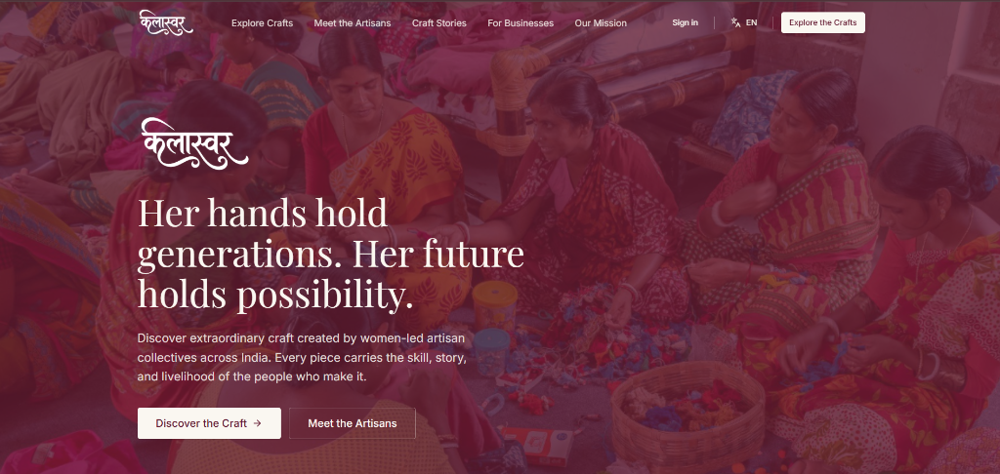
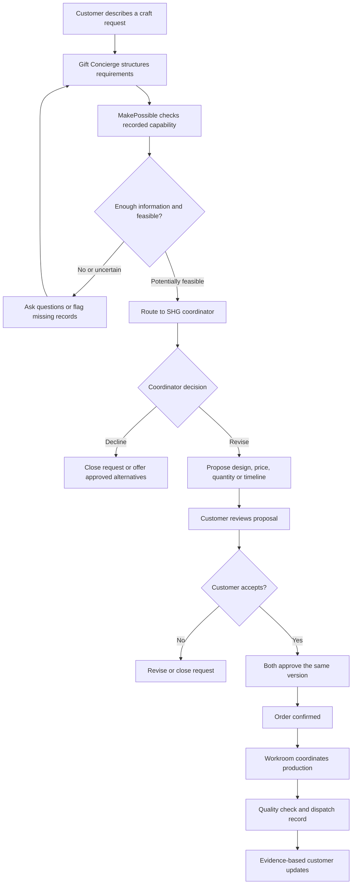
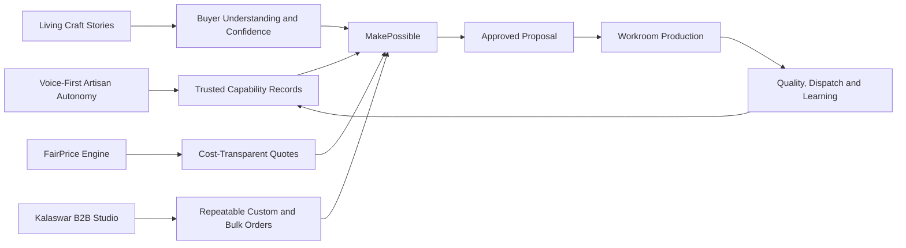
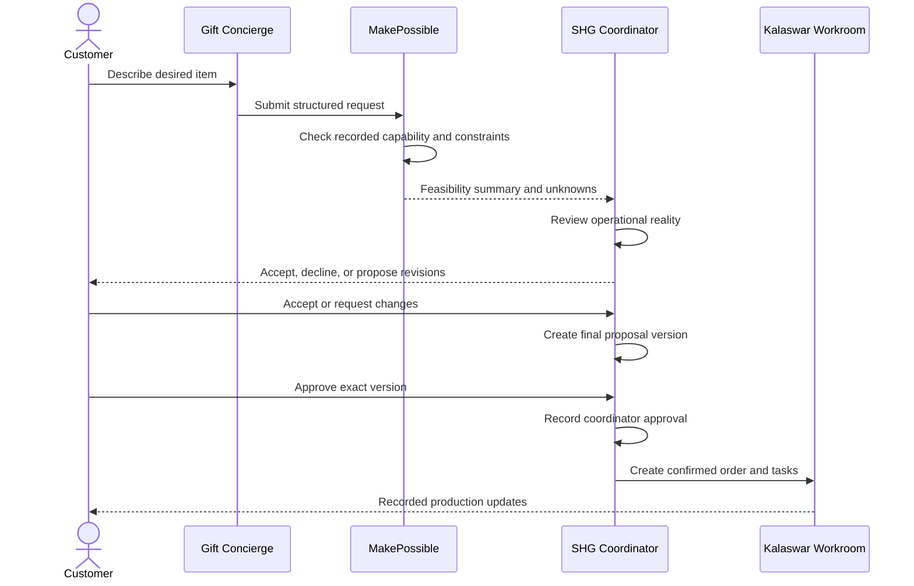
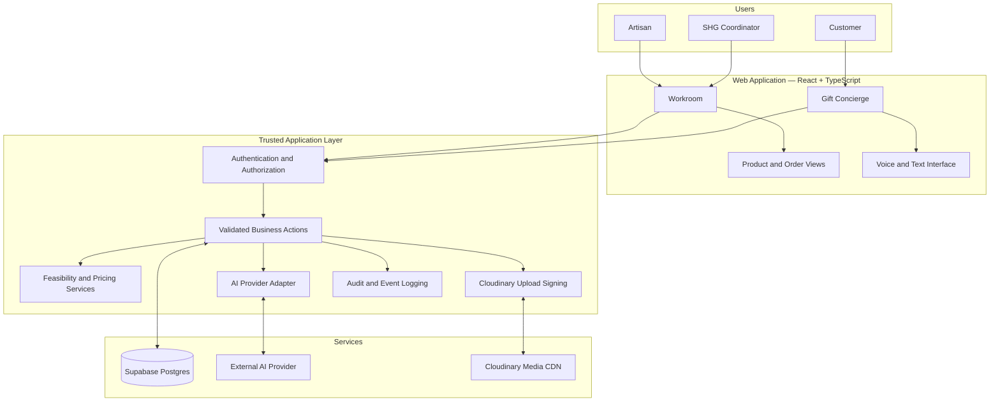
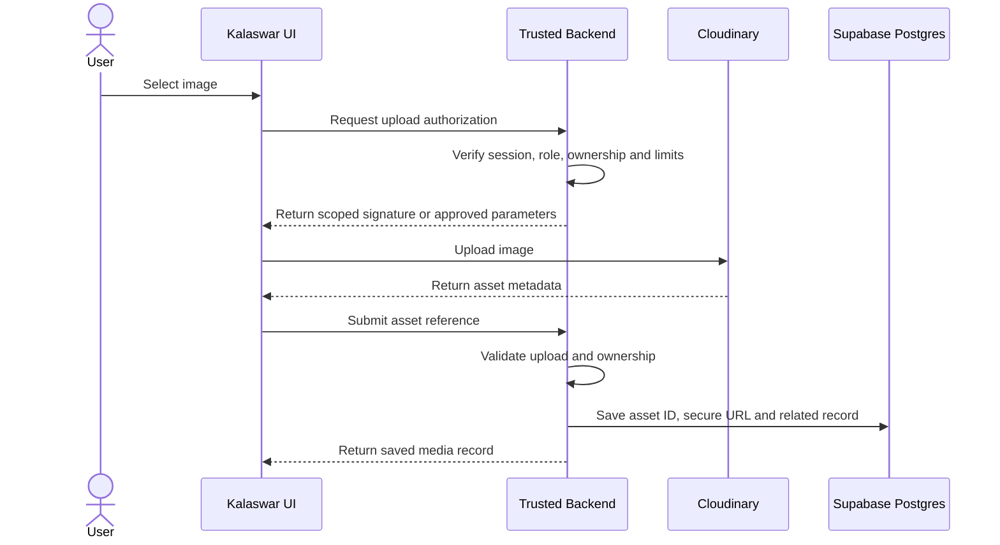
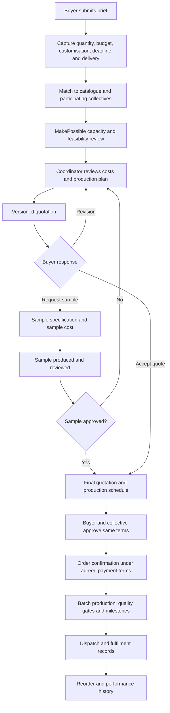
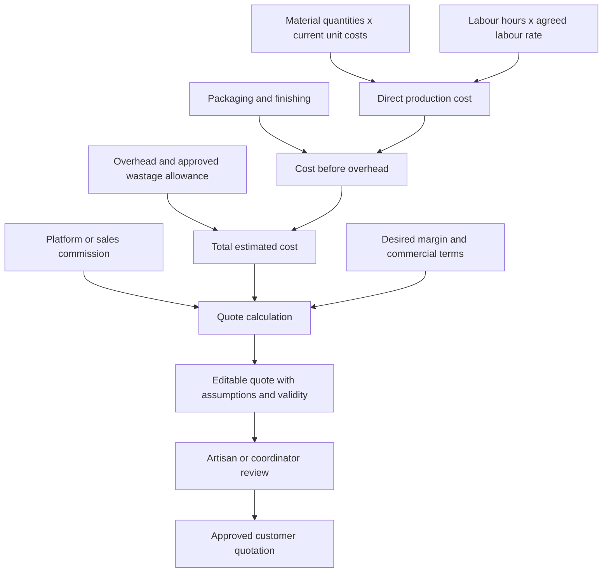
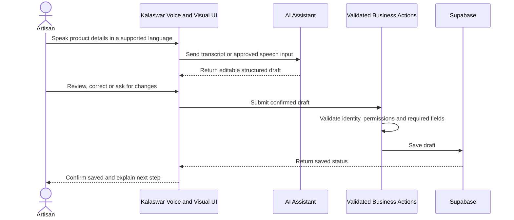

<div align="center">

# KALASWAR

### Craft, capability, and commerce — connected.

**A voice-first livelihood and production platform for women artisans and Self-Help Groups (SHGs).**


*From a customer's idea to a feasible, collectively produced craft order — with the people who make it at the centre.*

</div>

---



## Contents

- [Overview](#overview)
- [Problem Statement](#problem-statement)
- [Solution](#solution)
- [Why Kalaswar](#why-kalaswar)
- [Product Experiences and Features](#product-experiences-and-features)
- [Four Structural Problems Kalaswar Addresses](#four-structural-problems-kalaswar-addresses)
- [Signature USP: MakePossible](#signature-usp-makepossible)
- [Kalaswar B2B Studio](#kalaswar-b2b-studio)
- [FairPrice Engine](#fairprice-engine)
- [Living Craft Stories](#living-craft-stories)
- [Voice-First Artisan Autonomy](#voice-first-artisan-autonomy)
- [System Design](#system-design)
- [Technical Architecture](#technical-architecture)
- [Technology Stack](#technology-stack)
- [Cloudinary Integration](#cloudinary-integration)
- [AI and Voice Design](#ai-and-voice-design)
- [Data Model](#data-model)
- [Security and Responsible Design](#security-and-responsible-design)
- [Market Research and Context](#market-research-and-context)
- [Social Impact and Benefits](#social-impact-and-benefits)
- [Feasibility and Viability](#feasibility-and-viability)
- [Roadmap](#roadmap)
- [Success Metrics](#success-metrics)
- [Local Development and Deployment](#local-development-and-deployment)
- [Environment Configuration](#environment-configuration)
- [Implementation Status](#implementation-status)
- [Contributing](#contributing)
- [References](#references)

---

## Overview

Kalaswar is a proposed digital platform that connects women artisans, SHG coordinators, and customers through a shared workflow for craft capability, custom requests, production coordination, and order communication.

It brings together two connected experiences:

1. **Kalaswar Workroom** — a workspace for artisans and coordinators to manage skills, assignments, materials, product listings, production progress, quality checks, and order information.
2. **Kalaswar Gift Concierge** — a customer-facing experience for describing a personalised craft request and discovering whether a participating collective can realistically fulfil it.

These experiences are connected by **MakePossible**, a feasibility and negotiation workflow that compares customer requirements with recorded skills, materials, capacity, workload, cost, and timelines.

Kalaswar also addresses four structural gaps that can remain even when a marketplace provides online listings: dependence on digitally skilled intermediaries, shallow product storytelling, weak cost accounting, and limited operational support for repeatable B2B orders. These are treated as connected product capabilities, not separate add-ons.

> **Product principle:** AI can organise information and recommend next steps. Artisans and coordinators retain authority over feasibility, pricing, allocation, publication, and order commitments.

Kalaswar aims to support the work behind a handmade product, not simply display a catalogue. Its long-term value depends on trustworthy operational records, accessible interfaces, and validation with real artisan collectives.

### At a glance

| Area | Description |
|---|---|
| Primary users | Women artisans, SHG coordinators, customers seeking handmade or personalised products |
| Core problem | Fragmented information between craft capability, production coordination, and customer demand |
| Core solution | A shared workflow for feasibility assessment, proposal approval, production, and updates |
| Signature experience | MakePossible custom-order feasibility and two-sided approval |
| Four product pillars | Artisan autonomy, living craft stories, transparent costing, B2B order operations |
| B2B capability | Structured quote, sample approval, capacity-aware production, repeat-order history |
| Pricing | Editable cost build-up with input freshness and quote validity |
| Accessibility | Voice-first where supported, with text and visual alternatives |
| Media | Cloudinary for product media; asset metadata associated with application records |
| AI model | Human-approved, structured, and transparent about uncertainty |

---

## Problem Statement

The quality of a handmade product is only one part of a successful craft business. A collective must also understand who can make an item, which materials are available, how much work is already committed, what the item should cost, and whether it can be completed by the requested date.

When this information is scattered across conversations, notebooks, individual experience, and disconnected tools, coordination becomes difficult.

### Challenges Kalaswar is designed to address

- **Digital access barriers:** Typing-first interfaces and complex workflows can be difficult for people with different levels of digital literacy, language fluency, or connectivity.
- **Fragmented production information:** Skills, assignments, materials, availability, and progress may not be visible in one shared workflow.
- **Uncertain custom-order feasibility:** A request may arrive without a structured way to assess materials, capacity, cost, or timing.
- **Opaque pricing:** Materials, labour, overhead, and margin may not be recorded consistently or explained clearly.
- **Demand disconnected from planning:** Views, saves, enquiries, and confirmed orders indicate different levels of customer intent.
- **Limited fulfilment visibility:** Coordinators and customers need status updates grounded in actual production and dispatch records.
- **Unclear provenance:** Customers may want to know who made a product and how it was produced, while claims need to be represented with appropriate evidence.

These are the problems the product is designed to address. Their prevalence and severity should be validated with artisans and SHGs during discovery and pilot studies.

---

## Solution

Kalaswar connects **collective capability, customer intent, and production execution**.

1. **Record capability:** Maintain information about craft skills, materials, capacity, workload, and products.
2. **Capture customer intent:** Turn a customer's description into a structured request with editable details.
3. **Assess feasibility:** Compare the request with available records and flag missing information or constraints.
4. **Review with people:** Allow the coordinator to accept, decline, or propose revised terms.
5. **Agree on one specification:** Require customer and coordinator to approve the same version of the product, price, quantity, timeline, and delivery terms.
6. **Coordinate production:** Support assignments, craft guidance, progress recording, and quality checks.
7. **Communicate from records:** Show updates from saved events and verified integrations, not AI-generated assumptions.

### End-to-end workflow



*This describes the intended workflow. Payments, shipping, and notifications should only be described as live after their integrations have been implemented and tested.*

---

## Why Kalaswar

Kalaswar is built around the operational work behind a handmade product.

| Disconnected workflow | Kalaswar's intended approach |
|---|---|
| Customer discovery is separated from production capacity | Requests are checked against recorded skills, materials, workload, and timelines |
| Custom requests are negotiated informally | Requests become structured, reviewable proposals |
| AI can sound certain without evidence | Feasibility outputs expose missing information and uncertainty |
| Pricing assumptions are hard to inspect | Estimates show material, labour, overhead, and margin inputs |
| Status updates require repeated follow-up | Updates can be based on recorded production events |
| Changes can create confusion | Versioned specifications require renewed approval after material changes |
| Interfaces assume typing-first use | Voice interaction is paired with text and visual fallbacks |
| Provenance claims may be vague | Craft Passport records the source and verification status of claims |

### Core USP

> **“Imagine it. We’ll find out if it can be made.”**

The Gift Concierge and MakePossible workflow aims to connect a customer's personalised idea with the real capabilities and constraints of an artisan collective before a commitment is made.

This is a product positioning statement, not a claim that no comparable service exists. Competitive differentiation and willingness to pay must be tested through research and pilots.

---

## Product Experiences and Features

### 1. Kalaswar Workroom

A role-aware workspace for artisans and SHG coordinators.

**For artisans**
- View assignments, due dates, and work status.
- Access craft guidance and tutorials, with voice interaction where supported.
- Prepare editable product listing drafts through guided conversation.
- Add product photographs and descriptions.
- Review transparent pricing estimates.
- See recorded order progress and quality-check updates.
- Review sales, payments received, pending amounts, and expenses as distinct figures.

**For SHG coordinators**
- View active orders, deadlines, assignments, and production status.
- Allocate work using recorded skills, availability, workload, and capacity.
- Review inventory constraints and missing or stale records.
- Identify possible delays through explainable risk flags.
- Review and approve listings, prices, proposals, and commitments.
- Track quality checks and order milestones.
- Use demand signals to inform planning without treating attention metrics as confirmed demand.

**Production Risk Radar**

Risk indicators should explain why an order is flagged. They may use recorded progress, remaining work, available capacity, and time left. They must not present an opaque score as a definitive prediction.

**Transparent pricing**

A pricing estimate can use:

`Estimated price = materials + labour + overhead + margin`

The interface should show the inputs and assumptions. External comparable prices should only be used when the source and comparison basis are credible. Kalaswar must not fabricate market rates, demand, or earnings.

### 2. Kalaswar Gift Concierge

A guided customer experience for handmade or personalised products. It captures details such as:

- Occasion and recipient
- Product type, craft, style, and materials
- Personalisation requirements
- Quantity and budget
- Requested completion date
- Delivery location and requirements

The Concierge asks follow-up questions when important information is missing. Customers should review and edit the structured request before it is sent to a collective.

### 3. MakePossible

MakePossible is the feasibility and proposal layer between the customer and the SHG. It should communicate:

- What appears feasible based on current records
- Which skills or materials are required
- Whether relevant capacity is recorded
- Which constraints or missing facts need review
- What changes may make the request more realistic
- Which details require a coordinator's decision

**MakePossible is decision support, not an autonomous commitment engine.** Missing or stale data must not be interpreted as proof that a product can be made.

### 4. Craft Passport

A planned product-linked record that may include maker or collective attribution, craft technique, recorded materials, production milestones, quality checks, and provenance notes.

Claims should be labelled by source, for example **artisan-provided**, **collective-recorded**, or **independently verified**. A Craft Passport does not automatically make every claim independently verified.

### Feature summary

| Feature | User value | Required foundation |
|---|---|---|
| Voice-first guidance | Reduces typing burden | Speech support, language testing, text fallback |
| Listing assistant | Helps prepare product drafts | Structured AI output and approval flow |
| Cloudinary media | Managed image delivery | Secure upload and asset ownership checks |
| Skills-aware allocation | Helps match work to capability | Skills, availability, workload records |
| Production Risk Radar | Surfaces explainable concerns | Reliable milestones and deadlines |
| Inventory checks | Flags material constraints | Inventory records and freshness indicators |
| Pricing estimate | Makes cost assumptions visible | Materials, labour, overhead, margin |
| Gift Concierge | Structures custom requests | Guided intake and validation |
| MakePossible | Supports feasibility review | Skills, inventory, capacity, timeline |
| Versioned approvals | Keeps both sides aligned | Proposal versions and approval records |
| Production and QC tracking | Improves progress visibility | Saved production events and quality checks |
| Earnings summary | Separates sales, receipts, and expenses | Reconciled financial records |
| Craft Passport | Improves transparency | Consent, attribution, evidence, verification labels |

---

## Four Structural Problems Kalaswar Addresses

Kalaswar's product strategy is built around four connected challenges. They are design hypotheses grounded in sector research and observed marketplace patterns; their prevalence and severity must be validated with the specific artisan communities Kalaswar serves.

| Structural problem | Why it matters | Kalaswar response |
|---|---|---|
| **1. Middleman-dependent technology** | A seller portal can technically offer direct access while still requiring another person to photograph products, enter listings, update stock, respond to customers, and manage orders. | **Voice-First Artisan Autonomy:** guided voice and visual workflows, assisted listing creation, simple task cards, and clear confirmation screens. Coordinators can assist without becoming the sole owners of the account or decisions. |
| **2. Static product storytelling** | A single image and short description may not communicate process, skill, provenance, or the human work behind a handmade item. | **Living Craft Stories:** maker-approved stories, short process clips, technique explanations, material notes, and a Craft Passport that labels the source and verification status of each claim. |
| **3. Weak cost accounting** | If pricing ignores labour time, changing material costs, overhead, rejects, packaging, or platform fees, a sale can still be financially unsustainable. | **FairPrice Engine:** a transparent, editable cost sheet with labour hours, material quantities and rates, overhead, packaging, wastage allowance where appropriate, commission, margin, and quote validity. |
| **4. B2C-first order flows** | Large or custom orders require capacity checks, quotation versions, samples, approvals, production planning, delivery terms, and a clear change-control process. | **Kalaswar B2B Studio:** structured buyer briefs, bulk quantity and deadline capture, configurable quotation tiers, sample approval, production-capacity checks, milestone updates, and repeat-order records. |

### Product design principle

The goal is not to promise that technology can eliminate intermediaries. Some users will need onboarding or operational assistance. Kalaswar should make assistance **accountable and permissioned**, while preserving artisan ownership of profiles, pricing inputs, consent, and decisions.

### How the four pillars connect



---

## Signature USP: MakePossible

MakePossible must be a traceable workflow, not a single AI-generated “yes” or “no.”

### Feasibility inputs

| Input | Examples | Rule |
|---|---|---|
| Craft capability | Skills, techniques, experience notes | Do not infer a skill without evidence |
| Materials | Required items, available quantity, last-updated time | Flag missing or stale inventory |
| Capacity | Active workload, available workers, planned hours | Treat unrecorded capacity as unknown |
| Timeline | Requested deadline, estimated work, existing commitments | Show assumptions and uncertainty |
| Cost | Materials, labour, overhead, margin | Keep calculations reviewable |
| Customisation | Design, dimensions, colours, names, packaging | Preserve explicit final specifications |
| Delivery | Location, delivery window, dispatch needs | Do not promise a carrier service without a confirmed process or integration |

### Two-sided approval

Before confirming a custom order, both parties must approve the **same version** of the final specification. It should include the product/design, materials, technique, personalisation, quantity, price, timeline, dispatch/delivery terms, and cancellation or revision terms.

A material change after approval creates a new version and requires renewed approval from both parties. Earlier versions should remain available for audit.



---

## System Design

Kalaswar should be implemented as a modular application with clear boundaries between interface, business logic, data, AI, and media storage.

### High-level architecture



*This is the intended logical architecture. Confirm the actual deployment topology and integrations against the repository before treating them as implemented.*

### Architectural decisions

1. **Structured data is the source of truth.** Chat transcripts and model responses are not authoritative records of inventory, approvals, payments, shipments, or order status.
2. **Human approval for consequential actions.** AI may draft, summarise, and recommend. It must not independently publish listings, commit prices, or confirm custom orders.
3. **Validated business actions.** The AI layer should call a limited set of server-side actions with typed inputs and authorization checks, not unrestricted database credentials or arbitrary SQL.
4. **Explicit uncertainty.** Incomplete information triggers clarification or human review.
5. **Modular monolith first.** Keep deployment and debugging manageable while separating product, order, inventory, AI, media, and audit modules. Consider microservices only when justified by scale.
6. **Demo and production remain distinct.** Simulated data and actions must be labelled and must never masquerade as live payments, shipments, inventory, or orders.

### Suggested application layers

| Layer | Responsibility |
|---|---|
| Presentation | Responsive pages, accessible forms, role-aware navigation, voice/text UI |
| Domain services | Feasibility, pricing, allocation suggestions, proposal versions, order transitions |
| AI adapter | Provider-independent interface, structured outputs, bounded actions |
| Persistence | Postgres schema, migrations, constraints, transactions, RLS |
| Identity and access | Authentication, roles, group membership, server authorization |
| Media | Cloudinary upload flow, asset association, metadata persistence |
| Observability | Audit trail, error handling, integration health, tests |
| Deployment | Environment configuration, build checks, preview and production |

### Suggested business actions

Examples of narrow, validated actions:

- `create_custom_request`
- `update_custom_request_details`
- `evaluate_request_feasibility`
- `create_proposal_draft`
- `submit_proposal_for_review`
- `approve_proposal_version`
- `create_production_assignment`
- `record_production_event`
- `record_quality_check`
- `create_product_listing_draft`
- `publish_listing_after_approval`
- `create_cloudinary_upload_signature`

These are conceptual boundaries. Route names and implementation details should match the repository.

---

## Technical Architecture

### Technology stack

The following is the **target stack**, to be reconciled with the existing Lovable-generated repository before replacing working code.

| Technology | Role | Rationale |
|---|---|---|
| React + TypeScript | Web interface | Reusable components and typed application code |
| Vite, if already used | Frontend build tooling | Fast development and straightforward production builds |
| Supabase Auth | Authentication | Managed identity and sessions |
| Supabase Postgres | Database | Relational records, constraints, transactions, reporting |
| Supabase Row Level Security | Data access | Database-level group and user isolation |
| Cloudinary | Media storage and delivery | Managed uploads, transformations, CDN delivery |
| External AI API | Language understanding and structured assistance | Provider-backed AI using server-side credentials |
| Browser Speech APIs, where supported | Speech input/output | Progressive voice experience with fallback |
| Vercel | Hosting | Preview and production deployments |
| GitHub | Source control | Version history, review, deployment integration |

### Stack principles

- Preserve working project choices when compatible with requirements.
- Keep provider-specific AI code behind an adapter.
- Keep secrets server-side; never expose private keys via `VITE_*`, `NEXT_PUBLIC_*`, client bundles, or browser requests.
- Version database changes through migrations.
- Separate local, preview, demo, and production configuration.

---

## Cloudinary Integration

Cloudinary is intended to manage product images and approved media. The application database stores the metadata required to associate each asset with its owner and business record.

### Recommended upload flow



### Integration requirements

- Store `asset_id`, `public_id` where appropriate, `secure_url`, resource type, dimensions, timestamps, and related record ID.
- Verify the user's permission to associate an asset with a product or group.
- Restrict file formats, size, upload destinations, and transformations.
- Use server-signed uploads or a carefully restricted unsigned upload preset. Never ship the Cloudinary API secret to the browser.
- Do not trust client-submitted metadata without validating the upload result.
- Define media replacement, deletion, retention, and cleanup behaviour.
- Ensure public product images do not expose private documents or personal information.
- Provide progress, preview, failure, retry, and success states.

### Example environment configuration

```dotenv
# Client-visible values, if this is a Vite project
VITE_SUPABASE_URL=
VITE_SUPABASE_ANON_KEY=

# Server-side only
SUPABASE_SERVICE_ROLE_KEY=
CLOUDINARY_CLOUD_NAME=
CLOUDINARY_API_KEY=
CLOUDINARY_API_SECRET=

# Server-side AI configuration
AI_PROVIDER=
AI_API_KEY=
AI_MODEL=
```

This is illustrative, not a guarantee that the repository uses these exact variable names. Frontend-visible Supabase keys still require correctly configured Row Level Security. Privileged credentials must remain server-side.

---

## AI and Voice Design

AI should make Kalaswar easier to use while leaving business rules explicit.

### Suitable AI responsibilities

- Turn spoken or typed descriptions into editable listing drafts.
- Extract product type, materials, quantity, budget, and deadline.
- Ask follow-up questions when required fields are missing.
- Summarise feasibility evidence and explain constraints.
- Draft proposals or replies for coordinator review.
- Provide craft guidance grounded in approved resources where available.
- Translate or simplify instructions when the chosen model and language quality have been tested.

### Actions that must remain controlled

- Confirming inventory or artisan availability without current records
- Inventing prices, demand, or market statistics
- Publishing listings without explicit approval
- Committing custom-order terms without both approvals
- Marking payments as received without a verified record
- Claiming a parcel shipped or arrived without a real event
- Making opaque or discriminatory worker-allocation decisions

### Voice-first, not voice-only

1. Detect whether speech features are supported by the device and browser.
2. Offer voice interaction where available.
3. Display transcripts and editable structured fields.
4. Keep a complete text-based fallback.
5. Test speech recognition and text-to-speech across target languages and devices.
6. Never make essential functionality voice-only.

Language support should only be advertised after testing because browser speech capabilities vary by browser, operating system, and language.

---

## Kalaswar B2B Studio

Kalaswar B2B Studio extends the platform beyond one-off consumer purchases to structured custom and bulk orders from corporate gifting teams, interior designers, boutiques, hospitality businesses, event organisers, and other institutional buyers.

**Market-positioning note:** existing craft businesses and platforms already offer some bulk-order, custom-quotation, and sample workflows. Kalaswar should not claim that these capabilities do not exist anywhere. Its opportunity is to integrate buyer requirements with artisan-controlled voice workflows, cost transparency, collective capacity, sample approval, and versioned production commitments in one traceable system.

### B2B buyer journey



### B2B request fields

A B2B brief should capture, as relevant:

- Organisation and buyer contact
- Use case: employee gifts, client gifts, event merchandise, interiors, retail stock, or another purpose
- Product family, reference images, craft, materials, dimensions, finish, and branding requirements
- Quantity, variants, packaging, personalisation, and required sample
- Target budget or target unit cost
- Delivery date, destination, and whether deliveries are consolidated or multi-address
- Quote expiry, payment terms, taxes/invoicing requirements, and cancellation/change terms
- Quality standards, inspection criteria, and packaging requirements

Collect only the information needed for the enquiry and fulfilment process.

### Quotation and sample workflow

A quotation should include unit-cost assumptions, quantity breaks where operationally justified, tooling or setup costs where relevant, sample cost and timing, production lead time, packaging, delivery, applicable taxes, payment terms, validity period, and exclusions.

Sample status should be explicit: **not requested**, **requested**, **cost quoted**, **in production**, **ready for review**, **approved**, or **revision required**. Approval of a sample must be recorded and linked to the version of the specification it represents. Bulk production should not begin until required approvals and commercial terms are confirmed.

### Capacity-aware B2B planning

- Check current commitments, available labour, material availability, lead time, and quality-control capacity.
- Present a coordinator-reviewed production plan rather than an automated guarantee.
- Allow phased deliveries or alternative quantities only when the collective confirms them.
- Record changes to quantity, design, materials, or deadline as new quote/order versions.
- Use completed orders to support planning, but do not infer capacity from past output alone.

### B2B value

| Stakeholder | Intended value |
|---|---|
| Artisan collective | Better visibility into order scope, labour assumptions, deadlines, and approval history |
| Buyer | More structured quotations, sample decisions, and production updates |
| Coordinator | A shared record of capacity, costing, quality gates, and commitments |
| Customer or recipient | Better alignment between the approved design and delivered product |

---

## FairPrice Engine

FairPrice is a transparent costing and quotation assistant. It is not an opaque algorithm that dictates what an artisan should charge.

### Suggested price build-up



### Cost components

- **Materials:** quantity, unit, unit cost, supplier or source, and last-updated date.
- **Labour:** task-specific hours, rate, and the method used to estimate time.
- **Finishing and packaging:** packaging, labels, assembly, and other relevant direct costs.
- **Overhead:** a configurable allocation for shared costs such as utilities, tools, workspace, or administration.
- **Wastage and rework:** optional, evidence-based allowances where relevant to the craft; avoid blanket assumptions.
- **Platform commission and transaction fees:** displayed separately so the seller can see their effect.
- **Margin:** an explicit target or markup, chosen and approved by the artisan or authorised coordinator.
- **Logistics and taxes:** included or shown separately according to the quote terms and applicable rules.

### Example calculation model

For an internal estimate, define:

- `materials_cost = Σ(material_quantity × current_unit_cost)`
- `labour_cost = Σ(task_hours × agreed_hourly_rate)`
- `direct_cost = materials_cost + labour_cost + packaging + other_direct_costs`
- `estimated_cost = direct_cost + overhead + approved_wastage_allowance`
- `quote_total = estimated_cost + applicable commission/fees + desired profit + applicable taxes/logistics as specified`

The implementation must clearly distinguish **markup on cost** from **margin on selling price**; they are not interchangeable. Tax, commission, and payment-provider calculations should be configurable and reviewed for the actual business model rather than hard-coded as universal values.

### Material inflation and quote validity

- Store the unit cost and the date it was last confirmed.
- Allow authorised users to update supplier rates and retain a change history.
- Flag estimates that use stale material prices.
- Support quote expiry and recalculation when input prices change.
- Preserve the cost assumptions used in an approved quote so later updates do not silently rewrite existing commitments.
- Show both the estimate and the final human-approved price.

### Pricing safeguards

- Never infer labour as free because the work is home-based or family-based.
- Do not publish a quote solely because an AI model generated it.
- Do not silently lower the artisan's chosen labour rate to meet a buyer's budget.
- Allow the artisan or coordinator to challenge and edit assumptions.
- Keep platform fees visible.
- Separate an internal estimate from an approved customer quote.

---

## Living Craft Stories

Living Craft Stories extends a product page from a static catalogue entry into a maker-approved, evidence-aware record of the craft and process.

### Story components

- **Maker introduction:** optional name, collective, location at a privacy-appropriate level, and maker-approved biography.
- **Craft context:** craft tradition, technique, and context provided or reviewed by the maker or a qualified partner.
- **Process sequence:** selected stages such as preparation, weaving, carving, painting, finishing, or quality inspection.
- **Media:** product photography, short process clips, audio narration, or captions.
- **Materials and care:** material information and care guidance with clear sources.
- **Time and skill:** production time or technique details only when recorded or explicitly supplied.
- **Craft Passport:** a structured record linking the product to permitted attribution, production events, and verification notes.

### Trust and consent

- Obtain consent before publishing a person's name, face, voice, personal story, or location.
- Let makers review and approve the final story and media.
- Allow corrections and withdrawal of optional personal content.
- Attribute cultural information responsibly and avoid presenting a tradition as belonging to one person or group without basis.
- Label claims by source: **artisan-provided**, **collective-recorded**, or **independently verified**.
- Never use AI-generated imagery as if it were a photograph of the actual maker, process, or product.
- Keep original media and edited derivatives linked where practical.

### Why it matters

A story can help buyers understand the skill, time, and context behind a product. It does not automatically justify a higher price or prove authenticity. The effect on buyer trust, conversion, and willingness to pay should be measured in pilots.

---

## Voice-First Artisan Autonomy

Voice-first design is intended to reduce dependence on someone else for routine digital tasks. It must not be treated as a substitute for accessible interaction design, training, or human support.

### Example voice-led workflow



### Design requirements

- Use large, high-contrast controls, clear labels, short task sequences, and mobile-first layouts.
- Support audio prompts and read-back where tested and useful.
- Show the transcript and extracted fields so users can correct mistakes.
- Ask for explicit confirmation before publishing, sending a quote, changing a price, or confirming an order.
- Provide text, touch, and assisted alternatives if speech recognition fails.
- Make the account and its records belong to the artisan or collective, with clear permissions for helpers.
- Maintain an audit trail of actions taken by a coordinator, field officer, or support user.
- Never let an assistant silently change ownership, pricing authority, or consent settings.
- Test with real users across devices, accents, languages, noise conditions, literacy levels, and connectivity conditions.

### Measuring autonomy

Track the percentage of key tasks completed by artisans themselves, the number of support interventions required, error and correction rates, and user-reported confidence. Do not interpret low support usage as success unless users can complete tasks correctly and comfortably.

---

## Data Model

A relational model is recommended because the product links users, collectives, products, proposals, approvals, and order events.

| Entity | Purpose |
|---|---|
| `profiles` | User profile and account attributes |
| `shg_groups` | Collective details and coordinator ownership |
| `group_memberships` | User-to-group relationship and role |
| `artisan_skills` | Recorded skills, techniques, notes, and evidence |
| `materials_inventory` | Materials, quantities, units, last-updated time |
| `assignments` | Work allocation, owner, status, due date |
| `craft_guides` | Approved craft instructions and learning resources |
| `products` | Product details, listing status, pricing inputs |
| `custom_requests` | Customer requirements and request status |
| `proposals` | Negotiated proposal records |
| `proposal_versions` | Preserved versions of proposed or agreed terms |
| `proposal_approvals` | Approvals tied to a specific version |
| `orders` | Confirmed order and operational status |
| `production_events` | Recorded progress and production milestones |
| `quality_checks` | Inspection results, notes, evidence |
| `shipment_events` | Dispatch and delivery events from a verified process |
| `payments` | Payment references and verified status |
| `expenses` | Recorded production or operational costs |
| `media_assets` | Cloudinary metadata and linked business records |
| `craft_stories` | Maker-approved story sections, attribution, consent, and publication state |
| `story_media` | Approved images, audio, video, captions, and process-stage links |
| `cost_components` | Material, labour, overhead, packaging, fee, and margin inputs |
| `material_price_history` | Supplier price changes, source, and effective dates |
| `quotes` | Buyer quotation, validity, commercial terms, and status |
| `quote_versions` | Immutable revisions of scope, costing, and delivery terms |
| `sample_requests` | Sample specification, cost, status, and approval |
| `b2b_buyer_profiles` | Organisation and approved business contact details |
| `action_audit_logs` | Actor, action, target, timestamp, relevant changes |

### Data integrity rules

- Every business record has a clear owner or group association.
- Use foreign keys, constraints, and transactions where appropriate.
- Proposal approvals reference a specific version.
- An order is not confirmed until required approvals exist.
- Inventory, payment, and shipment statuses change through validated actions.
- Record freshness when it affects feasibility.
- Collect only personal information required by the workflow.

This is a proposed model; migrations should be reconciled with the current codebase and MVP scope.

---

## Security and Responsible Design

Kalaswar may handle identity, group membership, operational, and financial information. Security is a product requirement.

### Minimum safeguards

- Enforce Supabase Row Level Security for user and group data.
- Verify sensitive actions on the server; hiding a UI button is not authorization.
- Keep service-role keys, AI API keys, and Cloudinary secrets server-side.
- Validate request payloads and uploaded files.
- Apply upload limits, rate limits, and safe error handling.
- Audit listing publication, proposal approvals, assignment changes, and order-state changes.
- Separate demo data from production data.
- Avoid logging secrets, full payment details, or unnecessary personal information.
- Obtain consent for artisan names, photos, stories, and Craft Passport details.
- Treat AI output as untrusted input and validate it before taking action.
- Preserve histories of consequential changes.

### Trust commitments

The product should communicate what is known, estimated, missing, and verified. It must not present a simulated action as a completed transaction or imply independent verification where none exists.

---

## Market Research and Context

Kalaswar sits at the intersection of artisan livelihoods, SHG-based economic activity, digital commerce, and assisted digital workflows.

The sources below provide sector context. They do **not** prove Kalaswar's product-market fit, adoption, willingness to pay, or social impact.

### Relevant public context

- A Press Information Bureau release reported Indian handicraft exports, excluding hand-knotted carpets, at ₹33,122.79 crore in FY 2024–25 compared with ₹20,082.53 crore in FY 2014–15.
- A Ministry of Textiles / PIB report stated that more than 32 lakh artisans were registered under the Pehchan initiative by 2024, including nearly 20 lakh women.
- An eSARAS factsheet reported digital storefront access to more than 8.62 crore women SHG members as of February 2024. This is a reported ecosystem figure, not active Kalaswar demand.
- SEWA Cooperative Federation's March 2026 policy brief discusses barriers faced by women in the informal economy when participating in digital platforms.

### Market implications

| Observation | Potential implication | What to validate |
|---|---|---|
| Large artisan and SHG ecosystem | Potential stakeholder base exists | Which collectives have an urgent need and operational readiness |
| Digital commerce is established | Online discovery may complement existing sales | Customer interest and willingness to pay |
| Digital participation can involve barriers | Assisted onboarding and voice/text options may help | Actual device, language, connectivity needs |
| Custom work requires coordination | Feasibility records may add value beyond listings | Whether collectives can maintain accurate records |
| Provenance may matter to buyers | A Craft Passport may improve transparency | Which claims customers value and can be substantiated |

### Initial target segments

1. SHG coordinators managing artisans, materials, assignments, and customer commitments.
2. Women artisans who need accessible ways to document work and manage product information.
3. Customers seeking personalised craft products for gifts, events, or specific design requirements.
4. Potential institutional partners, including craft organisations, cooperatives, livelihood programmes, and social-impact initiatives.

### Market validation plan

Interview and pilot with target users to test current workflows, coordination costs, smartphone and connectivity access, language preference, custom-order interest, willingness to pay, trust requirements, onboarding effort, and ongoing support costs.

---

## Social Impact and Benefits

Kalaswar's intended social impact is to strengthen the infrastructure around women's craft work, not replace artisans' judgement or position AI as the maker.

### For women artisans

- Lower friction in recording and accessing work information
- More visibility into assignments and production progress
- A way to document skills and product knowledge
- Clearer cost breakdowns and payment records
- Potential access to additional customer enquiries

### For SHG coordinators

- A shared view of work, materials, capacity, and deadlines
- More explainable allocation and feasibility decisions
- Better records for workload discussions and coordination
- Fewer misunderstandings about custom-order terms

### For customers

- A clearer route from a personalised idea to a realistic proposal
- More transparent prices, timelines, and agreed specifications
- Better visibility into production milestones when records exist
- More informative maker and craft details with clear verification labels

### For the wider ecosystem

- Better structured records of skills and production activity
- A potential digital layer for craft organisations and livelihood programmes
- Opportunities to connect customer demand with real collective capability

### Impact principles

- **Agency:** Artisans and coordinators retain decision-making authority.
- **Fairness:** Allocation suggestions are explainable and reviewed by people.
- **Transparency:** Costs, assumptions, status, and verification labels are visible.
- **Consent:** Personal identity, photographs, and provenance details require permission.
- **Accessibility:** Essential tasks remain available without voice features.
- **Evidence:** Impact is measured, not assumed.


---

## Feasibility and Viability

### Technical feasibility

The MVP can use established web infrastructure: a React/TypeScript frontend, Supabase authentication and relational data, Cloudinary media, a server-side AI adapter, and Vercel deployment.

The central technical challenge is not a chat interface. It is connecting AI-assisted interaction to operational data, authorization, approvals, and reliable state transitions.

| Component | Feasibility | Main dependency or risk |
|---|---|---|
| Role-aware Workroom | High for MVP | Clear roles, group membership, RLS |
| Product listing drafts | High | Structured outputs and explicit publish approval |
| Cloudinary uploads | High | Secure upload and asset ownership checks |
| Basic pricing calculator | High | Agreed cost inputs and transparent formulas |
| MakePossible feasibility | Moderate | Accurate skills, inventory, capacity, timeline data |
| Proposal versions and approvals | High | Correct schema and state-transition rules |
| Voice interaction | Moderate | Browser support and language quality |
| Production risk indicators | Moderate | Reliable progress and workload records |
| Live payments and shipment tracking | Integration-dependent | Provider setup, verification, reconciliation |
| Craft Passport | Moderate | Consent, evidence, verification labels |
| Measurable livelihood impact | Requires pilot | Baseline, consent, and follow-up |

### Operational viability

A deployment also needs an operating model that defines who onboards collectives, maintains records, responds to custom requests, reviews estimates, handles quality issues and cancellations, communicates timeline changes, and supports users with limited connectivity or digital confidence.

### Potential sustainability models to test

These are hypotheses, not established revenue streams:

- Service fee on successfully fulfilled custom orders
- Subscription or service contract for partner organisations
- Institutional partnerships with livelihood programmes or craft networks
- Optional services such as catalogue setup, fulfilment support, or product documentation

The model must be tested with SHGs and customers and should not shift unreasonable fees or risks onto artisans.

### Risks and mitigations

| Risk | Mitigation |
|---|---|
| Inaccurate or stale capacity data | Show data freshness, flag unknowns, require coordinator review |
| AI overstates feasibility | Evidence-based summaries, uncertainty labels, human approval |
| Low digital adoption | Co-design, onboarding, voice and text testing |
| Credential exposure | Server-side secrets, scoped uploads, access controls |
| Disputes over custom terms | Version proposals; both parties approve the same version |
| Unverified impact claims | Establish baseline and publish measured results only |
| High support costs | Pilot with a small number of collectives and measure effort |
| Demo mistaken for production | Label simulated data and show integration status |

---

## Roadmap

Prioritise one complete, reliable workflow rather than many disconnected screens.

### Phase 1 — Foundation
- Audit the existing Lovable-generated repository and current demo.
- Confirm framework, routes, dependencies, and build status.
- Define schema, roles, and Row Level Security.
- Set up environment configuration, migrations, and seed data.

### Phase 2 — Workroom vertical slice
- Authenticate users and enforce role/group permissions.
- Create and view product records.
- Implement secure Cloudinary uploads.
- Save listing drafts and require approval before publication.
- Record assignments and basic production events.

### Phase 3 — Gift Concierge and MakePossible
- Capture structured customer requests.
- Evaluate feasibility against recorded data.
- Flag missing or stale records.
- Add coordinator accept/decline/revise decisions.
- Implement proposal versions and two-sided approval.

### Phase 4 — Production visibility and voice
- Add production milestones and quality checks.
- Show customer updates from saved events.
- Add voice interaction where supported, retaining text fallback.
- Add transparent price estimates and explainable risk indicators.

### Phase 5 — Pilot readiness
- Test security, permissions, error paths, and mobile usability.
- Validate language support with target users.
- Prepare onboarding and support processes.
- Run a small pilot with consent and baseline measurements.
- Improve using observed results before scaling.

---

## Success Metrics

Distinguish product activity from real-world outcomes.

| Dimension | Example measure |
|---|---|
| Activation | Share of onboarded users completing a first meaningful task |
| Accessibility | Task completion by input mode, device, and tested language |
| Listing workflow | Draft-to-approval rate and time |
| Custom requests | Share with sufficient information for coordinator review |
| Feasibility quality | Difference between system assessment and coordinator decision |
| Proposal clarity | Changes or disputes caused by misunderstood terms |
| Production reliability | On-time completion against baseline |
| Inventory quality | Share of records updated within the freshness window |
| Customer experience | Completion, repeat use, satisfaction, complaints |
| Artisan value | Changes in net earnings, paid work, administrative time |
| Operational viability | Support effort, cost per active collective, cost per order |
| Trust | Approval errors, false status claims, privacy incidents, disputes |

Disaggregate metrics only when safe, useful, consented to, and unlikely to expose individuals or small groups.

---

## Local Development and Deployment

Commands depend on the repository's actual framework and package manager. Verify `package.json` before using these examples.

### Prerequisites

- Node.js compatible with the project
- npm, pnpm, or the repository's package manager
- GitHub repository
- Supabase project
- Cloudinary account
- External AI provider credentials
- Vercel account, if Vercel is the chosen host

### Example setup

```bash
git clone <your-repository-url>
cd <repository-directory>

# Use the package manager specified by the repository
npm install

# Copy the example configuration
cp .env.example .env.local

# Run the script defined in package.json
npm run dev
```


## Environment Configuration

Create `.env.example` with variable names and blank or safe placeholder values. Never commit `.env`, `.env.local`, API keys, service-role keys, upload signatures, or production credentials.

| Variable | Exposure | Purpose |
|---|---|---|
| `VITE_SUPABASE_URL` | Client-visible | Supabase URL, if using Vite |
| `VITE_SUPABASE_ANON_KEY` | Client-visible | Public/anonymous key; requires correct RLS |
| `SUPABASE_SERVICE_ROLE_KEY` | Server-only | Privileged server access |
| `CLOUDINARY_CLOUD_NAME` | Depends on usage | Cloudinary account identifier |
| `CLOUDINARY_API_KEY` | Server-side where signing | Cloudinary API operations |
| `CLOUDINARY_API_SECRET` | Server-only | Signed media operations |
| `AI_PROVIDER` | Server configuration | Selected provider adapter |
| `AI_API_KEY` | Server-only | External AI credentials |
| `AI_MODEL` | Server configuration | Supported model identifier |

## References

1. **Press Information Bureau, Government of India — handicrafts export context.** Reported exports excluding hand-knotted carpets of ₹33,122.79 crore in FY 2024–25 versus ₹20,082.53 crore in FY 2014–15. [PIB](https://pib.gov.in/)
2. **Press Information Bureau / Ministry of Textiles — Pehchan artisan registration context.** Reported more than 32 lakh registered artisans by 2024, including nearly 20 lakh women. [PIB](https://pib.gov.in/)
3. **eSARAS — women SHG digital storefront context.** A February 2024 factsheet reported digital storefront access for more than 8.62 crore women SHG members. This is not a count of active Kalaswar users. [eSARAS](https://www.esaras.in/)
4. **SEWA Cooperative Federation — digital platform barriers.** March 2026 policy brief on barriers faced by women in the informal economy when participating in digital platforms. [SEWA Cooperative Federation](https://www.sewafederation.org/)
5. **Catalyst Impact Accelerator — artisan digital readiness.** Research on digital skills, marketplace onboarding, product listing, business operations, and women's agency. [Exploring digital solutions to Indian artisans' distress](https://catalystaic.org/exploring-digital-solutions-to-indian-artisans-distress/) and [Artisans in India and their quest for growth](https://catalystaic.org/artisans-in-india-and-their-quest-for-growth-understanding-the-current-set-of-capabilities-among-indian-artisans-to-adopt-digital-technology-solutions/)
6. **Aruna Ranganathan — artisan identity and price setting.** Research on how audience and product attachment can influence artisans' pricing decisions. [Administrative Science Quarterly article](https://journals.sagepub.com/doi/10.1177/0001839217725782)
7. **Existing B2B and bulk-order examples.** [Direct Create B2B](https://www.directcreate.com/b2b), [The India Craft House wholesale](https://theindiacrafthouse.com/pages/wholesale), and [Cauvery Emporium customisation](https://www.cauveryecom.savithru.in/customization-info) illustrate that bulk orders and customisation already exist in parts of the market. These are examples for competitive analysis, not exhaustive market coverage.

The figures describe the wider ecosystem, not outcomes delivered by Kalaswar. Treat them as contextual inputs and verify them before publication.

---

<div align="center">

### KALASWAR

**A more connected path from craft capability to meaningful opportunity.**

*Designed around people. Grounded in records. Built for accountable collaboration.*

</div>

