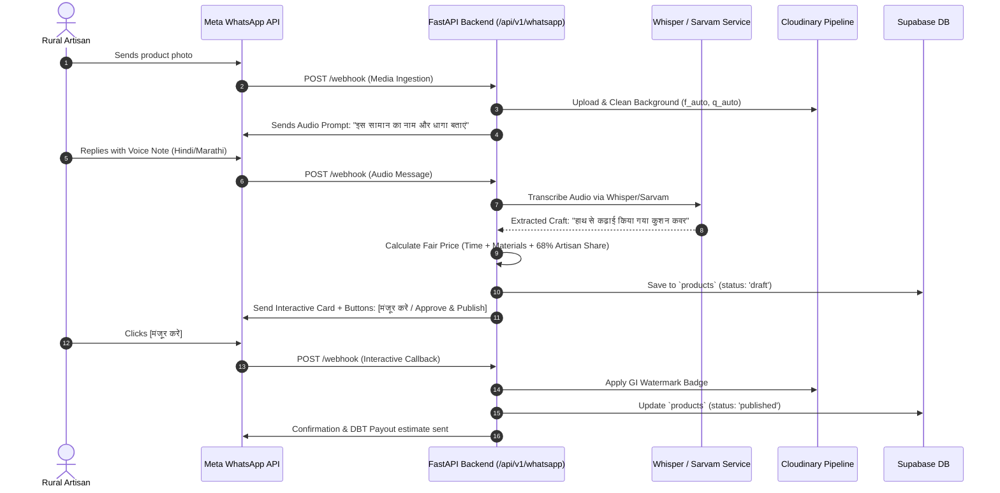
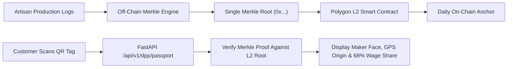

# Kalaswar System Architecture

**Platform:** Enterprise Operating System & Direct-to-Market Craft Ecosystem  
**Target Architecture:** Supabase + FastAPI + React Web + Expo Mobile  
**Audience:** 3-Person Engineering Team (Web, WhatsApp/Backend, Blockchain) & AI Agents  

---

## 1. High-Level System Topology

Kalaswar bridges rural Self-Help Groups (SHGs) under India's DAY-NRLM mission with high-value B2B and B2C markets through a multi-tier, decoupled architecture:

```
+--------------------------------------------------------------------------------------------------+
|                                        CLIENT SURFACES                                           |
+------------------------------------+----------------------------------+-------------------------+
| Rural Artisans                     | SHG Coordinators & B2B Buyers    | Retail Shoppers         |
| Primary Interface: WhatsApp Bot    | Web Workroom & B2B Studio        | Web Storefront & QR     |
| (Meta WhatsApp Business API)       | (React 19 + TanStack Start)      | (Public Web & Mobile)   |
+-----------------+------------------+----------------+-----------------+------------+------------+
                  |                                   |                              |
                  | Webhook / Ingestion               | HTTP / JSON                  | HTTP / QR
                  v                                   v                              v
+--------------------------------------------------------------------------------------------------+
|                                    KALASWAR FASTAPI BACKEND                                      |
|                                                                                                  |
|  • /api/v1/whatsapp/  : WhatsApp Bot Webhook & Interactive Message Engine                        |
|  • /api/v1/voice/     : Whisper & Sarvam AI Voice Ingestion Pipeline                             |
|  • /api/v1/products/  : Auto-Listing Engine & Dynamic Pricing Calculator                         |
|  • /api/v1/dpp/       : Merkle Batching & Digital Product Passport (DPP) Engine                  |
+-------------------+---------------------------------+------------------------------+-------------+
                    |                                 |                              |
                    | DB Queries & Mutations          | Signed Uploads               | Merkle Root
                    v                                 v                              v
+-----------------------------+     +-------------------------------+   +--------------------------+
|       SUPABASE POSTGRES     |     |        CLOUDINARY CDN         |   |    POLYGON L2 CHAIN      |
|  • Postgres 15+ Relational  |     |  • `f_auto,q_auto` Media      |   |  • Daily Merkle Commit   |
|  • Row Level Security (RLS) |     |  • Background Cleanup         |   |  • Proof Verification    |
|  • Supabase Auth & Storage  |     |  • Dynamic GI Watermarking    |   |  • PO Factoring Escrow   |
+-----------------------------+     +-------------------------------+   +--------------------------+
```

---

## 2. Core Architecture Tiers

### 2.1 Database & Security: Supabase (Postgres, Auth, RLS)
- **Database Engine:** Supabase PostgreSQL with versioned SQL migrations in `supabase/migrations/` and demo seed in `supabase/seed.sql`.
- **Row Level Security (RLS):** All data access enforces RLS policies. In production, policies verify JWT user roles (`admin`, `coordinator`, `artisan`, `customer`, `buyer`). For development and hackathon walkthroughs, demo mode allows unauthenticated exploration on public catalog tables while marking demo writes with explicit status flags.
- **Relational Tables:**
  - `shg_clusters`: Cluster identity, state SRLM affiliation, and bank DBT accounts.
  - `artisans`: Identity, SHG linkage, dialect preference, and verification credentials.
  - `products`: Catalog items, price breakdown, Cloudinary public IDs, and availability.
  - `dpp_passports`: Immutable cryptographic passport records, Merkle roots, on-chain transaction hashes, and QR URLs.
  - `po_factoring`: Corporate purchase orders, invoice factoring advances, and escrow release conditions.
  - `orders`, `order_events`, `custom_requests`, `proposals`: End-to-end production tracking and MakePossible two-sided approvals.

### 2.2 Backend Services: FastAPI (Python 3.12)
- **Role:** High-performance orchestration engine hosting business logic, external AI gateways, media optimization, and webhook dispatch.
- **API Standard:** Fully typed OpenAPI 3.0 contract documented interactively at `/api/v1/docs`.
- **CORS & Multi-Client Support:** Configured to serve both web applications (`localhost:5173`) and mobile clients.

### 2.3 Web Application: React 19 + TanStack Start (`web/`)
- **Role:** Comprehensive portal supporting B2C Storefront, MakePossible Gift Concierge, SHG Coordinator Workroom, and B2B Sourcing Studio.
- **Data Access:** Reads and mutations interface with Supabase directly (enforcing RLS) for instant queries, and call the FastAPI service for AI transcription, Cloudinary signing, and blockchain passport generation.

### 2.4 Mobile Application: Expo (`mobile/`)
- **Role:** Field tool for SHG Coordinators and Community Resource Persons (CRPs).
- **Future Roadmap (Phase 2):** Offline-first inventory counting, village-level quality checks, and Edge AI Computer Vision (YOLOv8/TFLite) for fabric inspection before dispatch.

---

## 3. Integration Points for the WhatsApp Teammate

The WhatsApp teammate develops the primary conversational interface for rural women artisans. The FastAPI backend provisions dedicated endpoints and workflows for this:



### Key Technical Contracts for WhatsApp:
1. **Webhook Verification:** `GET /api/v1/whatsapp/webhook` verifies Meta `hub.challenge` using `WHATSAPP_VERIFY_TOKEN`.
2. **Event Ingestion:** `POST /api/v1/whatsapp/webhook` processes incoming voice notes, images, and button clicks (`payload.entry`).
3. **Auto-Listing Pipeline:** `POST /api/v1/whatsapp/draft-listing` receives raw media, invokes transcription, calculates fair retail price, and returns an interactive review card.
4. **Outbound Push Notifications:** FastAPI background tasks trigger WhatsApp outbound template messages for:
   - Order assignment notifications.
   - Production timeline alerts.
   - Real-time Direct Benefit Transfer (DBT) payment receipts.

---

## 4. Integration Points for the Blockchain Teammate

The blockchain teammate implements unalterable provenance, Digital Product Passports (DPP), and PO micro-factoring. To maintain low transaction fees (< $0.001/unit), Kalaswar uses **Layer-2 Merkle Tree Batching**:



### Key Technical Contracts for Blockchain:
1. **Batching Endpoint:** `POST /api/v1/dpp/batch-commit`
   - Accepts a batch of up to 500 completed product/order UUIDs.
   - Builds a cryptographic Merkle tree off-chain.
   - Submits only the root hash to the lightweight Polygon L2 smart contract.
   - Stores `merkle_root` and `polygon_tx_hash` in `dpp_passports`.
2. **Passport Resolution:** `GET /api/v1/dpp/passport/{product_id}`
   - Resolves a scanned physical QR token.
   - Returns artisan profile, GPS cluster origin, craft technique, wage breakdown, and on-chain verification status.
3. **PO Micro-Factoring Escrow:**
   - Tokenizes approved corporate Purchase Orders (POs) into invoice assets.
   - Releases a 70% raw material advance directly to the SHG bank account.
   - Automated escrow releases the remaining 30% margin upon customer delivery confirmation.

---

## 5. Teammate Workspaces & Execution Boundaries

| Teammate | Focus Area | Primary Directories | Contract Dependency |
| :--- | :--- | :--- | :--- |
| **Web Teammate** | Storefront, Workroom, B2B Studio | `web/` | Reads Supabase via RLS; calls FastAPI for AI/DPP |
| **WhatsApp Teammate** | Meta Bot, Voice STT, Media Ingestion | `backend/app/routers/whatsapp.py`, `backend/app/services/` | Supabase `products`, `artisans` tables |
| **Blockchain Teammate** | L2 Smart Contracts, Merkle Batching | `backend/app/routers/dpp.py`, `backend/app/services/merkle_service.py` | Supabase `dpp_passports`, `po_factoring` |
