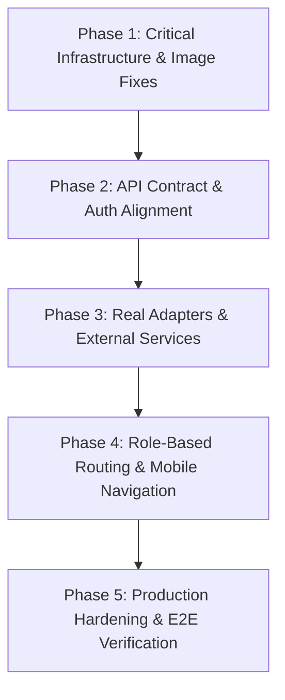

# Kalaswar Production Readiness Gap Audit Report

**Date:** October 31, 2026  
**Branch:** `Fix/project`  
**Audit Scope:** Fullstack codebase (`web/src/`, `mobile/src/`, `backend/app/`, `supabase/migrations/`, `supabase/seed.sql`)  
**Methodology:** Read-only code inspection, backend test verification (`pytest`), and API contract comparison against `backend/openapi.json`. No browser automation was executed.

---

## 1. Executive Summary

This comprehensive audit evaluates the **Kalaswar** decentralized artisan platform to identify every component, data structure, API call, and architectural choice that renders the current application a demonstration prototype rather than a production-ready enterprise product.

While the project features deterministic domain logic (such as FairPrice cost build-up and MakePossible craft feasibility algorithms) and passing backend tests (74/74 unit and integration tests passing in FastAPI), the user-facing web and mobile applications remain heavily coupled to mock data, simulated timeouts, in-memory state stores, and disconnected third-party stubs.

### Key High-Level Findings:
1. **Broken Core User Journeys:** Three reported bugs (artisan story addition failure, mobile camera button navigation redirect loop, and broken home page imagery) stem directly from hardcoded dead demo IDs, conflicting Expo Router layouts, and unmigrated Lovable cloud asset URLs.
2. **Dual-Tier Mock Fallbacks:** Both web and mobile applications aggressively swallow API network failures and silently fall back to hardcoded in-memory arrays and simulated state.
3. **Contract Drift:** Over 12 API calls made by the web and mobile frontends either do not exist on the FastAPI backend, target differing path structures, omit mandatory authorization headers, or bypass backend services entirely by issuing unvetted direct database mutations.
4. **Mocked Infrastructure Adapters:** AI transcription, Cloudinary image enhancement, and Layer-2 blockchain provenance commit engines operate as simulated in-memory mocks, silently substituting demo assets when production credentials are absent.

---

## 2. Root Cause Analysis for Reported Failures

### 2.1 (a) "Something went wrong" when Adding an Artisan Story

* **Reported Symptom:** Submitting or drafting a living craft story from the artisan workspace triggers an immediate error toast stating: *"Something went wrong."* (`common_error`).
* **Root Causes:**
  1. **Foreign Key Violation on Hardcoded Demo ID:**
     * **File:** [web/src/lib/constants.ts](file:///d:/Sambhav/code/Hackathons/Kalaswar/kalaswar/web/src/lib/constants.ts#L22)
     * **Code:** `export const DEMO_ARTISAN_ID = "11111111-0000-0000-0000-000000000004";`
     * **Mechanism:** In [web/src/components/artisan/artisan-app.tsx](file:///d:/Sambhav/code/Hackathons/Kalaswar/kalaswar/web/src/components/artisan/artisan-app.tsx#L53), `useState(DEMO_ARTISAN_ID)` passes this ID into `<StoryEditorSection>` ([L636](file:///d:/Sambhav/code/Hackathons/Kalaswar/kalaswar/web/src/components/artisan/artisan-app.tsx#L636)). When the artisan clicks **Save draft** or **Publish** ([web/src/components/artisan/story-editor.tsx](file:///d:/Sambhav/code/Hackathons/Kalaswar/kalaswar/web/src/components/artisan/story-editor.tsx#L83-L95)), `saveCraftStory` in [web/src/lib/data.ts](file:///d:/Sambhav/code/Hackathons/Kalaswar/kalaswar/web/src/lib/data.ts#L1707) issues an `insert` into `public.craft_stories` with `artisan_id = '11111111-0000-0000-0000-000000000004'`.
     * **Database Conflict:** In [supabase/migrations/0000_kalaswar_schema_and_demo_data.sql](file:///d:/Sambhav/code/Hackathons/Kalaswar/kalaswar/supabase/migrations/0000_kalaswar_schema_and_demo_data.sql#L102-L108), the seeded artisans for the `11111111` SHG cluster are only `...0001` (Meenakshi Devi), `...0002` (Sunita Kumari), and `...0003` (Kamla Devi). Artisan ID `...0004` does not exist. PostgreSQL rejects the write with a foreign key constraint violation (`craft_stories_artisan_id_fkey`). The Supabase client throws an error, invoking `onError: () => toast.error(t("common_error"))` at [web/src/components/artisan/story-editor.tsx:109](file:///d:/Sambhav/code/Hackathons/Kalaswar/kalaswar/web/src/components/artisan/story-editor.tsx#L109).
  2. **Dead Lovable AI Gateway in AI Story Drafting:**
     * **File:** [web/src/lib/story-organiser.ts](file:///d:/Sambhav/code/Hackathons/Kalaswar/kalaswar/web/src/lib/story-organiser.ts#L33-L45)
     * **Code:** Line 33 checks `process.env["LOVABLE_API_KEY"]` and connects to `https://ai.gateway.lovable.dev` using model `openai/gpt-6-astra`.
     * **Mechanism:** When the user clicks the **Draft with AI** button (`Sparkles` icon) in [web/src/components/artisan/story-editor.tsx:236](file:///d:/Sambhav/code/Hackathons/Kalaswar/kalaswar/web/src/components/artisan/story-editor.tsx#L236), `organiseMutation` executes `organiseStoryNotes`. Because `LOVABLE_API_KEY` is not present in `.env` (and Lovable cloud gateways are deprecated in self-hosted setups), the server function throws `Error("AI is not configured on the server.")`, which triggers `onError: () => toast.error(t("common_error"))` at [L134](file:///d:/Sambhav/code/Hackathons/Kalaswar/kalaswar/web/src/components/artisan/story-editor.tsx#L134).
  3. **Backend API Bypass:**
     * Rather than calling the backend FastAPI endpoint `POST /api/v1/craft-stories` (defined in [backend/app/api/v1/endpoints/craft_stories.py:112](file:///d:/Sambhav/code/Hackathons/Kalaswar/kalaswar/backend/app/api/v1/endpoints/craft_stories.py#L112)), `web/src/lib/data.ts` attempts direct browser-to-database PostgREST mutations.

---

### 2.2 (b) Mobile "Add New Product" Button Redirects to Home

* **Reported Symptom:** Tapping the primary **"Add a product · नया सामान जोड़ें"** button in the mobile app redirects the user back to the Artisan Home screen rather than opening the camera capture flow.
* **Root Causes:**
  1. **Route Name Ambiguity & Collision in Expo Router:**
     * **File 1:** [mobile/src/app/(tabs)/artisan/camera.tsx](file:///d:/Sambhav/code/Hackathons/Kalaswar/kalaswar/mobile/src/app/(tabs)/artisan/camera.tsx#L1-L3)
     * **File 2:** [mobile/src/app/artisan/camera.tsx](file:///d:/Sambhav/code/Hackathons/Kalaswar/kalaswar/mobile/src/app/artisan/camera.tsx#L16)
     * **Mechanism:** In Expo Router, route groups enclosed in parentheses (e.g., `(tabs)`) are omitted from the URL path. Therefore, both `mobile/src/app/(tabs)/artisan/camera.tsx` and `mobile/src/app/artisan/camera.tsx` resolve to the identical pathname `/artisan/camera`.
  2. **Hidden Tab Screen Resolution with `href: null`:**
     * **File:** [mobile/src/app/(tabs)/_layout.tsx](file:///d:/Sambhav/code/Hackathons/Kalaswar/kalaswar/mobile/src/app/(tabs)/_layout.tsx#L120-L124)
     * **Code:**
       ```tsx
       <Tabs.Screen
         name="artisan/camera"
         options={{ href: null }}
       />
       ```
     * In [mobile/src/app/(tabs)/artisan/products.tsx:315](file:///d:/Sambhav/code/Hackathons/Kalaswar/kalaswar/mobile/src/app/(tabs)/artisan/products.tsx#L315) and [mobile/src/app/(tabs)/artisan/index.tsx:314](file:///d:/Sambhav/code/Hackathons/Kalaswar/kalaswar/mobile/src/app/(tabs)/artisan/index.tsx#L314), the button executes `router.push('/artisan/camera')`.
     * Because navigation is triggered from within the `(tabs)` navigator, Expo Router prioritizes the local tab match `artisan/camera`. However, because `href: null` explicitly disables linking/navigation for that tab, the router fails to transition into the tab, dropping back to the root tab route `/(tabs)`.
  3. **Index Fallback Redirect to Home:**
     * **File:** [mobile/src/app/(tabs)/index.tsx](file:///d:/Sambhav/code/Hackathons/Kalaswar/kalaswar/mobile/src/app/(tabs)/index.tsx#L10-L12)
     * **Code:**
       ```tsx
       if (role === 'artisan') {
         return <Redirect href="/artisan" />;
       }
       ```
     * When unhandled navigation falls through to `(tabs)/index.tsx`, `TabsIndex` executes an immediate `<Redirect href="/artisan" />`, redirecting the artisan straight back to the Home tab.

---

### 2.3 (c) Images on the Home Page Do Not Load

* **Reported Symptom:** Featured products, category discovery tiles, collective group photos, and artisan portraits on the web and mobile landing pages display broken image placeholders.
* **Root Causes:**
  1. **Unmigrated Lovable Internal Proxy URLs (`/__l5e/`):**
     * **Database Seed File:** [supabase/migrations/0000_kalaswar_schema_and_demo_data.sql](file:///d:/Sambhav/code/Hackathons/Kalaswar/kalaswar/supabase/migrations/0000_kalaswar_schema_and_demo_data.sql#L103-L120)
     * **Migration File:** [supabase/migrations/0001_kalaswar_product_image_urls.sql](file:///d:/Sambhav/code/Hackathons/Kalaswar/kalaswar/supabase/migrations/0001_kalaswar_product_image_urls.sql#L1-L10)
     * **Mechanism:** Every seeded product row and artisan row in Supabase contains image paths referencing `/__l5e/assets-v1/...` (e.g., `/__l5e/assets-v1/a4f4afce-47e8-4d6f-aedc-0d00d3878cf6/product-tote.jpg`). The prefix `/__l5e` is Lovable.dev's cloud-internal asset proxy. In standard local development and self-hosted deployments (Vite/TanStack Start), this path returns HTTP 404 (or returns Vite's fallback HTML).
  2. **Missing Binary Assets Replaced by Stale JSON Pointers:**
     * **File:** [web/src/lib/constants.ts](file:///d:/Sambhav/code/Hackathons/Kalaswar/kalaswar/web/src/lib/constants.ts#L1-L10)
     * **Code:**
       ```ts
       import bagsPointer from "@/assets/image.png.asset.json";
       import shgGroupPointer from "@/assets/image-2.png.asset.json";
       import workingPointer from "@/assets/image-3.png.asset.json";

       export const IMG = {
         bags: bagsPointer.url,        // "/__l5e/assets-v1/7e443b28.../image.png"
         shgGroup: shgGroupPointer.url,// "/__l5e/assets-v1/21f73a68.../image-2.png"
         working: workingPointer.url,  // "/__l5e/assets-v1/3c14172d.../image-3.png"
       };
       ```
     * In [web/src/assets/](file:///d:/Sambhav/code/Hackathons/Kalaswar/kalaswar/web/src/assets), the binary image files `image.png`, `image-2.png`, and `image-3.png` do not exist. Only JSON descriptors referencing Lovable's dead CDN proxy are present.
  3. **Dead Logo Pointer:**
     * In [web/src/routes/index.tsx:16](file:///d:/Sambhav/code/Hackathons/Kalaswar/kalaswar/web/src/routes/index.tsx#L16) and [L520](file:///d:/Sambhav/code/Hackathons/Kalaswar/kalaswar/web/src/routes/index.tsx#L520), `logoWhite.url` points to `kalaswar-logo-white.png.asset.json` which resolves to a non-existent `/__l5e/` path.
  4. **Mobile Image Loader Blindly Uses Database Proxy Paths:**
     * In [mobile/src/hooks/queries/use-products.ts:137](file:///d:/Sambhav/code/Hackathons/Kalaswar/kalaswar/mobile/src/hooks/queries/use-products.ts#L137):
       ```ts
       image_url: item.image_url || SEEDED_PRODUCTS[idx % SEEDED_PRODUCTS.length].image_url
       ```
     * When Supabase returns rows with `/__l5e/...`, React Native's `<Image source={{ uri: '/__l5e/...' }} />` attempts to load a relative path without host or protocol, failing silently.

---

## 3. Mock and Hardcoded Data Audit

A systematic scan of `web/src/` and `mobile/` revealed widespread simulated state, hardcoded data arrays, fake network delays, and fallback mocks.

| File Path | What It Fakes | Mechanism / Code Marker | Real Production Endpoint / Service Required |
| :--- | :--- | :--- | :--- |
| `web/src/lib/constants.ts:22` | Artisan Identity | `DEMO_ARTISAN_ID = "11111111-0000-0000-0000-000000000004"` | Authenticated profile lookup (`GET /api/v1/auth/me`) |
| `web/src/components/demo-mode-banner.tsx:10-11` | Environment Mode | `isDemoMode = (env["VITE_DEMO_MODE"] === "true") \|\| true;` (hardcoded always true) | Server configuration query (`GET /api/v1/health`) |
| `web/src/components/upi-pay-dialog.tsx:76-102` | Payment Gateway | Static UPI string generation (`upi://pay?pa=...`), mock QR, `<DemoNote>` | Payment Gateway SDK & Webhooks (Razorpay / Cashfree UPI intent) |
| `web/src/lib/data.ts:799-807` | Audit Logs | `actor: "Kalaswar app — demonstration"`; swallowed error block | `POST /api/v1/audit/logs` with authenticated session user |
| `web/src/lib/fairprice.ts:1-120` | Material & Labor Costing | Deterministic client-side constants (hardcoded 15% wastage, 12% margin) | `POST /api/v1/pricing/calculate` / `POST /api/v1/pricing/fairprice/estimate` |
| `web/src/lib/makepossible.ts:1-250` | Production Feasibility | Client-side rule evaluation against hardcoded skill matrices | `POST /api/v1/makepossible/evaluate` |
| `web/src/routes/auth.tsx:46-51` | Login Credentials | `DEMO_PRESETS`: hardcoded passwords (`demo-pass-123`) for 4 roles | Real user authentication (`supabase.auth.signInWithPassword`) |
| `mobile/src/hooks/use-auth.tsx:24-49` | User Accounts | `DEMO_ACCOUNTS`: hardcoded Sunita, Anita, Priya credentials | Real database authentication (`POST /api/v1/auth/me`) |
| `mobile/src/hooks/use-auth.tsx:196-215` | Auth Fallback | Silent offline mock login when Supabase is unreachable | Standard error propagation (throw `AuthError`) |
| `mobile/src/hooks/queries/use-products.ts:21-106` | Product Catalog | `SEEDED_PRODUCTS`: 6 hardcoded mock products with Unsplash images | `GET /api/v1/products` |
| `mobile/src/hooks/queries/use-products.ts:145` | Query Failure Fallback | Silently catches errors and returns `SEEDED_PRODUCTS` | React Query `isError` boundary with user-facing retry prompt |
| `mobile/src/hooks/queries/use-coordinator.ts:26-58` | Coordinator Stats | `SEEDED_COORDINATOR_OVERVIEW`: hardcoded pending reviews, low stock, risk flags | `GET /api/v1/dashboard/coordinator` |
| `mobile/src/hooks/queries/use-coordinator.ts:68-124` | Material Inventory | `FALLBACK_INVENTORY`: 6 hardcoded silk/cotton/dye stock records | `GET /api/v1/inventory/materials` |
| `mobile/src/hooks/queries/use-artisan-tasks.ts:40-150` | Artisan Work Queue | `FALLBACK_TASKS`: 3 hardcoded production tasks with mock stages | `GET /api/v1/orders` / `GET /api/v1/assignments` |
| `mobile/src/app/artisan/task/[id].tsx:51-61` | Voice Note Input | `handleVoiceInput`: 2-second `setTimeout` injecting static text `'धागा कम पड़ गया है'` | `POST /api/v1/voice/transcribe` via device microphone |
| `mobile/src/app/artisan/camera.tsx:40-45` | Audio Guidelines | `handlePlayAudio`: 4-second `setTimeout` simulating audio playback | Device audio player or `POST /api/v1/voice/synthesize` |
| `mobile/src/app/artisan/camera.tsx:139-145` | Camera Viewfinder | Unsplash static photograph simulating camera preview | `expo-camera` live camera stream |
| `mobile/src/app/coordinator/approvals.tsx:16-35` | Product Approvals | `inMemoryReviews`: hardcoded mock review queue | `GET /api/v1/products?status=in_review` |
| `backend/app/api/v1/endpoints/craft_stories.py:141` | Story Persistence | In-memory `DEMO_STORIES = []` array | Persistent database writes via Supabase PostgREST |
| `backend/app/api/v1/endpoints/payouts.py:20-37` | Wage Disbursements | In-memory `DEMO_PAYOUTS` with `reference: "DBT-DEMO-PFMS-984210"` | Direct Benefit Transfer / Bank PFMS gateway integration |
| `backend/app/services/factoring.py:39-60` | Purchase Order Escrow | In-memory dictionary `self._pos` with simulated advance disbursements | On-chain escrow contract & Banking escrow partner |

---

## 4. API Contract Verification & Discrepancies

Comparing the frontend API invocations against `backend/openapi.json` reveals significant discrepancies, including missing endpoints, mismatched HTTP verbs, missing authorization headers, and bypassed API routes.

### 4.1 Frontend Calls With No Backend Endpoint (404)
1. `GET /api/v1/auth/users` ([web/src/features/admin/hooks.ts:50](file:///d:/Sambhav/code/Hackathons/Kalaswar/kalaswar/web/src/features/admin/hooks.ts#L50))
   * **Discrepancy:** Endpoint does not exist in FastAPI router. Backend only implements `/api/v1/auth/me` and role-check stubs.
2. `PATCH /api/v1/auth/users/{userId}/role` ([web/src/features/admin/hooks.ts:59](file:///d:/Sambhav/code/Hackathons/Kalaswar/kalaswar/web/src/features/admin/hooks.ts#L59))
   * **Discrepancy:** Missing role administration endpoint.
3. `GET /api/v1/auth/settings/demo-mode` ([web/src/features/admin/hooks.ts:78](file:///d:/Sambhav/code/Hackathons/Kalaswar/kalaswar/web/src/features/admin/hooks.ts#L78))
   * **Discrepancy:** Missing backend demo-mode configuration endpoint.
4. `POST /api/v1/auth/settings/demo-mode` ([web/src/features/admin/hooks.ts:87](file:///d:/Sambhav/code/Hackathons/Kalaswar/kalaswar/web/src/features/admin/hooks.ts#L87))
   * **Discrepancy:** Missing demo-mode toggle endpoint.
5. `GET /api/v1/assignments/suggestions` ([web/src/features/orders/hooks.ts:182](file:///d:/Sambhav/code/Hackathons/Kalaswar/kalaswar/web/src/features/orders/hooks.ts#L182))
   * **Discrepancy:** Missing AI/heuristic artisan assignment recommendation endpoint.
6. `POST /api/v1/products/{id}/publish` ([web/src/features/products/hooks.ts:168](file:///d:/Sambhav/code/Hackathons/Kalaswar/kalaswar/web/src/features/products/hooks.ts#L168))
   * **Discrepancy:** Missing specific publishing endpoint. Backend requires `PATCH /api/v1/products/{product_id}` with `{ "availability": true }`.
7. `GET /api/v1/products/validation-queue` ([web/src/features/products/hooks.ts:186](file:///d:/Sambhav/code/Hackathons/Kalaswar/kalaswar/web/src/features/products/hooks.ts#L186))
   * **Discrepancy:** Missing coordinator validation queue endpoint. Backend only supports `GET /api/v1/products?category=...`.
8. `POST /api/v1/products/{id}/validate` ([web/src/features/products/hooks.ts:195](file:///d:/Sambhav/code/Hackathons/Kalaswar/kalaswar/web/src/features/products/hooks.ts#L195))
   * **Discrepancy:** Missing product approval validation endpoint.
9. `POST /api/v1/proposals/{id}/decline` ([web/src/features/proposals/hooks.ts:176](file:///d:/Sambhav/code/Hackathons/Kalaswar/kalaswar/web/src/features/proposals/hooks.ts#L176))
   * **Discrepancy:** Missing proposal rejection endpoint. Backend only implements `/approve`, `/revise`, and `/submit`.
10. `GET /api/v1/artisans` ([web/src/routes/workroom.artisans.tsx:34](file:///d:/Sambhav/code/Hackathons/Kalaswar/kalaswar/web/src/routes/workroom.artisans.tsx#L34))
    * **Discrepancy:** Endpoint does not exist in FastAPI backend. Backend has no `/artisans` router.

### 4.2 Calls Made Without Required Auth Headers
1. `GET /api/v1/dashboard/coordinator` ([mobile/src/hooks/queries/use-coordinator.ts:220](file:///d:/Sambhav/code/Hackathons/Kalaswar/kalaswar/mobile/src/hooks/queries/use-coordinator.ts#L220))
   * **Discrepancy:** Raw `fetch` call without `Authorization` header. Backend dependency `require_roles(["coordinator", "admin"])` returns HTTP 401 Unauthorized.
2. `GET /api/v1/assignments` ([mobile/src/hooks/queries/use-coordinator.ts:261](file:///d:/Sambhav/code/Hackathons/Kalaswar/kalaswar/mobile/src/hooks/queries/use-coordinator.ts#L261))
   * **Discrepancy:** Raw `fetch` call without `Authorization` header. Backend rejects with 401.
3. `POST /api/v1/assignments` ([mobile/src/hooks/queries/use-coordinator.ts:319](file:///d:/Sambhav/code/Hackathons/Kalaswar/kalaswar/mobile/src/hooks/queries/use-coordinator.ts#L319))
   * **Discrepancy:** Raw `fetch` call without `Authorization` header. Backend rejects with 401.
4. `POST /api/v1/internal/whatsapp/approve` ([mobile/src/hooks/queries/use-coordinator.ts:366](file:///d:/Sambhav/code/Hackathons/Kalaswar/kalaswar/mobile/src/hooks/queries/use-coordinator.ts#L366))
   * **Discrepancy:** Raw `fetch` call omitting required `X-Service-Token` header. Backend returns 401 AuthError.
5. `GET /api/v1/orders` ([mobile/src/hooks/queries/use-orders.ts:69](file:///d:/Sambhav/code/Hackathons/Kalaswar/kalaswar/mobile/src/hooks/queries/use-orders.ts#L69))
   * **Discrepancy:** Raw `fetch` call without `Authorization` header. Backend dependency `get_current_user` rejects with 401.
6. `PATCH /api/v1/orders/{orderId}/status` ([mobile/src/hooks/queries/use-orders.ts:131](file:///d:/Sambhav/code/Hackathons/Kalaswar/kalaswar/mobile/src/hooks/queries/use-orders.ts#L131))
   * **Discrepancy:** Raw `fetch` call without `Authorization` header. Backend rejects with 401.
7. `POST /api/v1/shipments` ([mobile/src/hooks/queries/use-orders.ts:166](file:///d:/Sambhav/code/Hackathons/Kalaswar/kalaswar/mobile/src/hooks/queries/use-orders.ts#L166))
   * **Discrepancy:** Raw `fetch` call without `Authorization` header. Backend rejects with 401.

### 4.3 Architecture Disconnect: Direct DB Access vs Backend API
A major structural discrepancy exists across both web and mobile:
* `web/src/lib/data.ts` queries Supabase PostgREST tables (`products`, `orders`, `craft_stories`, `custom_requests`, `story_consents`, `action_audit_logs`) directly from the browser, bypassing FastAPI entirely.
* Concurrently, `backend/app/api/v1/endpoints/` maintains in-memory lists (`DEMO_ORDERS`, `DEMO_STORIES`, `DEMO_PAYOUTS`) that do not stay in sync with Supabase tables.

---

## 5. Roles & RBAC Architecture

### 5.1 Roles Inventory Across the System

| Role Name | DB Enum (`app_role`) | Supabase RLS Support | Backend Guards (`deps.py`) | Web Route Guard (`guards.ts`) | Mobile Navigation Tabs | Self-Signup Eligible |
| :--- | :---: | :---: | :---: | :---: | :---: | :---: |
| **`admin`** | Yes (0004) | Full access across tables | Yes (`require_role("admin")`) | Yes (`requireRole("admin")`) | Normalized to `coordinator` | No |
| **`coordinator`**| Yes (0004) | Scoped via `is_shg_coordinator` | Yes (`require_role("coordinator")`) | Yes (`requireRole("coordinator")`) | Dedicated Coordinator Tabs | No |
| **`artisan`** | Yes (0004) | Scoped via `is_org_artisan` | Yes (`require_role("artisan")`) | Yes (`requireRole("artisan")`) | Dedicated Artisan Tabs | No |
| **`customer`**| Yes (0004) | Public reading, own requests | Implicit / Optional Auth | Public / Allowed | Dedicated Shopper Tabs | **Yes** (Default) |
| **`buyer`** | Yes (0010) | Scoped to own RFPs/quotes | Yes (`require_role("buyer")`) | Allowed on public routes | Normalized to `shopper` | **Yes** (Metadata) |
| **`financier`**| Yes (0013) | Scoped to PO factoring/escrow | Yes (`require_role("financier")`) | **None** (Not in `KwRole`) | Normalized to `shopper` | No |

### 5.2 Dashboard Reachability Analysis

```
Role         Allowed Web Destination             Allowed Mobile Destination      Gaps / Failures
---------------------------------------------------------------------------------------------------------
admin        /workroom/admin                     /coordinator (mapped)           No web user role editor UI
coordinator  /workroom (and subroutes)           /coordinator (and subtabs)      Mobile API calls fail (no auth)
artisan      /workroom/artisan, /artisan-space   /artisan (and subtabs)          Story editor fails with 500/FK
customer     /shop, /product/$id, /concierge     /shopper (and subtabs)          Broken product images
buyer        /b2b (and subroutes)                /shopper (normalized)           Auth redirects to /shop, not /b2b
financier    None (No web routes exist)          /shopper (normalized)           No frontend UI exists
```

* **Buyer Redirect Gap:** In [web/src/features/auth/auth-provider.tsx:129](file:///d:/Sambhav/code/Hackathons/Kalaswar/kalaswar/web/src/features/auth/auth-provider.tsx#L129), `getRedirectForRole("buyer")` returns `"/shop"`. Buyers who authenticate through the B2B portal are unexpectedly routed to the retail consumer storefront instead of `/b2b`.
* **Missing Financier UI:** While migration 0013 and backend factoring endpoints support the `financier` role, neither the web nor mobile app provides a dedicated dashboard or routing shell for financiers.
* **Unprotected Workroom Routes:** The legacy coordinator dashboard at `/shg` ([web/src/routes/shg.tsx:27](file:///d:/Sambhav/code/Hackathons/Kalaswar/kalaswar/web/src/routes/shg.tsx#L27)) and B2B portal at `/b2b` ([web/src/routes/b2b.tsx:20](file:///d:/Sambhav/code/Hackathons/Kalaswar/kalaswar/web/src/routes/b2b.tsx#L20)) lack `beforeLoad` role guards, allowing unauthenticated guests to access internal controls.

---

## 6. Adapters, Missing Environment Keys & Silent Fallbacks

### 6.1 Adapters State & Fallback Audit

| Adapter Type | File Location | Configured Class | Fallback / Mock Class | Active Default | Silent Fallback Paths |
| :--- | :--- | :--- | :--- | :--- | :--- |
| **Speech-to-Text (STT)** | `backend/app/adapters/stt.py` | `SarvamSttAdapter`, `WhisperSttAdapter` | `MockSttAdapter` | Dynamic (Mock if keys missing) | Lines 44 & 75: Sarvam falls back to mock on missing key or error.<br>Lines 89 & 116: Whisper falls back to mock on missing key or error. |
| **LLM Extraction** | `backend/app/adapters/llm.py` | `OpenAiLlmAdapter` | `MockLlmAdapter` | Dynamic (Mock if `OPENAI_API_KEY` missing) | Line 106: Missing OpenAI key triggers mock.<br>Line 153: Any OpenAI exception silently returns mock extraction. |
| **Media Pipeline** | `backend/app/adapters/cloudinary.py` | `CloudinaryAdapter` (live signed) | In-memory deterministic mock | Dynamic (Mock if keys missing) | Line 56: If unconfigured, returns `https://res.cloudinary.com/kalaswar-demo/...`<br>Line 119: Any upload exception falls back to demo asset. |
| **Blockchain L2** | `backend/app/adapters/chain.py` | `PolygonChainAdapter` (Skeleton) | `MockChainAdapter` | **`MockChainAdapter`** | `get_chain_adapter()` defaults to mock unless `CHAIN_ADAPTER_TYPE="polygon"`.<br>Even if polygon is set, `PolygonChainAdapter.commit_root` only calls `eth_blockNumber` and returns a dummy SHA256 string. |

### 6.2 Environment Variable Status

| Variable Name | Environment File | Present / Configured | Impact if Missing |
| :--- | :--- | :---: | :--- |
| `CHAIN_ADAPTER_TYPE` | `backend/.env` | ❌ Missing | System defaults to `MockChainAdapter` for all Merkle commits. |
| `DPP_CONTRACT_ADDRESS` | `backend/.env` | ❌ Empty | Blockchain L2 adapter cannot interact with a deployed smart contract. |
| `DPP_PRIVATE_KEY` | `backend/.env` | ❌ Missing | Transactions cannot be cryptographically signed. |
| `WHATSAPP_TOKEN` | `backend/.env` | ❌ Empty | Meta WhatsApp Cloud API outbound messages fail. |
| `WHATSAPP_PHONE_NUMBER_ID` | `backend/.env` | ❌ Empty | Meta WhatsApp webhook receiver cannot identify sender number. |
| `LOVABLE_API_KEY` | `web/.env` | ❌ Missing | Web AI story organizer (`organiseStoryNotes`) and legacy SSR voice routes fail. |
| `VITE_CLOUDINARY_CLOUD_NAME` | `web/.env` | ❌ Missing | Client-side Cloudinary upload widgets cannot initialize signed uploads. |
| `VITE_CLOUDINARY_UPLOAD_PRESET`| `web/.env` | ❌ Missing | Client-side unsigned direct uploads fail. |

---

## 7. Feature Inventory per User Type

Every major feature across the four target personas was evaluated against live code and backend endpoints.

### 7.1 Artisan Persona

| Feature | Target Experience | Current Status | Concrete Evidence |
| :--- | :--- | :---: | :--- |
| **Voice-First Listing** | 3-step listing (Photo + Vernacular Voice Note + Review) | **FAKE** | Mobile camera button redirects to Home (`artisan/products.tsx:315`). Voice screen uses mock simulated timers. Viewfinder uses static Unsplash image. |
| **Living Craft Stories** | Maker writes raw notes, AI drafts from notes only, maker edits & approves | **BROKEN** | Saving fails with "Something went wrong" (`common_error`) due to Foreign Key violation (`DEMO_ARTISAN_ID` not in DB). AI button fails due to unset `LOVABLE_API_KEY`. |
| **Work Assignments** | Track assigned orders and production milestones | **WORKING** (Web)<br>**FAKE** (Mobile) | Web reads from Supabase under RLS. Mobile uses `FALLBACK_TASKS` with mock stage progression. |
| **Wage Ledger & DBT** | Transparent view of direct bank deposits and piece-rate earnings | **FAKE** | Backend `/api/v1/payouts` returns in-memory `DEMO_PAYOUTS` with mock PFMS reference strings. |
| **Audio Voice Prompts** | Spoken Hindi instructions for semi-literate makers | **FAKE** | Tapping audio icons runs `setTimeout` without playing any sound (`camera.tsx:42`, `products.tsx:29`). |
| **Artisan Profile** | Craft classification and preferred vernacular language (Hindi/Marathi) | **WORKING** | Stored in `profiles.preferred_language`, changes i18n between English, Hindi, and Marathi. |

---

### 7.2 SHG Coordinator Persona

| Feature | Target Experience | Current Status | Concrete Evidence |
| :--- | :--- | :---: | :--- |
| **Workroom Dashboard** | Aggregated view of cluster orders, stock levels, and production risks | **WORKING** (Web)<br>**BROKEN** (Mobile) | Web queries Supabase. Mobile `useCoordinatorOverview` makes unauthenticated raw `fetch` to backend, gets 401, falls back to `SEEDED_COORDINATOR_OVERVIEW`. |
| **Order Assignment** | Allocate incoming orders to specific artisans based on capacity | **WORKING** (Web)<br>**BROKEN** (Mobile) | Web updates `order_assignments` table. Mobile `useAssignments` fails with 401. |
| **Raw Material Inventory** | Track stock levels, unit costs, and reorder alerts | **WORKING** (Web)<br>**FAKE** (Mobile) | Web queries `materials_inventory`. Mobile uses hardcoded `FALLBACK_INVENTORY`. |
| **Listing Approvals** | Review artisan voice submissions and approve for public catalog | **FAKE** | Mobile uses in-memory `inMemoryReviews` list; approval calls `/internal/whatsapp/approve` without service token. |
| **FairPrice Calculator** | Transparent cost build-up with time and material factors | **WORKING** | Deterministic calculations pass in `web/src/lib/fairprice.ts` and backend `POST /api/v1/pricing/calculate`. |
| **MakePossible Engine** | Capacity & skill matching against incoming custom orders | **WORKING** | Tested and verified in `web/src/lib/makepossible.ts` and `backend/app/services/makepossible.py`. |
| **DPP QR & Provenance** | Batch production logs into Merkle roots and anchor on Polygon | **FAKE** | `MockChainAdapter` generates fake tx hashes; `PolygonChainAdapter` is an unconfigured stub calling `eth_blockNumber`. |

---

### 7.3 Customer Individual (B2C) Persona

| Feature | Target Experience | Current Status | Concrete Evidence |
| :--- | :--- | :---: | :--- |
| **Storefront Browsing** | Discover authentic handcrafted goods by collective | **BROKEN** | Product images and category tiles fail to load because image URLs in DB point to dead `/__l5e/assets-v1/...` paths. |
| **Cart & Checkout** | Cart management with item quantities and checkout flow | **WORKING** (Web)<br>**FAKE** (Mobile) | Web correctly communicates with `/api/v1/cart/*`. Mobile shopper cart displays static placeholder items. |
| **UPI Direct Payment** | Pay collectives directly via UPI QR code | **FAKE** | Renders static UPI string with `<DemoNote>Demonstration — UPI payments are simulated</DemoNote>`. No webhook or bank reconciliation. |
| **Custom Concierge** | Submit custom craft requests with reference images | **WORKING** | Successfully writes records into `custom_requests` table. |
| **DPP Public Verification** | Scan QR code on physical product to verify authentic maker | **WORKING** | `/passport/:token` retrieves passport and validates Merkle inclusion against root (though anchored on mock chain). |
| **Stories Viewer** | Read maker-approved living stories on product pages | **WORKING** | Correctly filters and displays published stories adhering to maker consent switches. |

---

### 7.4 Customer B2B (Corporate / Wholesale) Persona

| Feature | Target Experience | Current Status | Concrete Evidence |
| :--- | :--- | :---: | :--- |
| **B2B Sourcing Studio** | Browse collective capacities and craft techniques for wholesale | **WORKING** | Accessible at `/b2b` and `/b2b/discover`. |
| **RFP Brief Submission** | Submit structured custom request with quantity and delivery specs | **WORKING** | Writes into `buyer_requests` table. |
| **Quotation Negotiation** | Versioned quotation review, acceptance, and revision loops | **WORKING** (Web)<br>**BROKEN** (API) | Web UI handles revisions; backend endpoint `POST /api/v1/proposals/{id}/decline` is missing (404). |
| **Sample Tracking** | Track dispatch and evaluation of production prototypes | **WORKING** | Updates `sample_requests` and `sample_events` in database. |
| **PO Micro-Factoring** | Tokenized purchase orders and escrow-backed working capital | **FAKE** | State is held strictly in an in-memory dictionary (`self._pos`) in `backend/app/services/factoring.py`. |
| **Buyer Onboarding** | B2B registration and auto-redirection to corporate portal | **BROKEN** | Signup form accepts `buyer`, but `getRedirectForRole("buyer")` routes the user to consumer `/shop`. |

---

## 8. Prioritized Fix Plan

The roadmap below organizes remediation into five sequential phases to transition Kalaswar from a hackathon demo into an enterprise-grade product.



### Phase 1: Critical Infrastructure & Broken Journeys (Immediate Unblockers)
1. **Fix Product & Asset Images:**
   * Run a database migration updating all product `image_url` and artisan `photo_url` records in Supabase, replacing `/__l5e/assets-v1/...` with valid HTTPS image URLs (or hosted Cloudinary assets).
   * Update [web/src/lib/constants.ts](file:///d:/Sambhav/code/Hackathons/Kalaswar/kalaswar/web/src/lib/constants.ts) to remove JSON pointer imports and reference authentic public assets.
2. **Resolve Mobile Camera Route Collision:**
   * Delete redundant [mobile/src/app/(tabs)/artisan/camera.tsx](file:///d:/Sambhav/code/Hackathons/Kalaswar/kalaswar/mobile/src/app/(tabs)/artisan/camera.tsx) and remove its entry from [mobile/src/app/(tabs)/_layout.tsx](file:///d:/Sambhav/code/Hackathons/Kalaswar/kalaswar/mobile/src/app/(tabs)/_layout.tsx).
   * Configure root Stack in [mobile/src/app/_layout.tsx](file:///d:/Sambhav/code/Hackathons/Kalaswar/kalaswar/mobile/src/app/_layout.tsx) so `router.push('/artisan/camera')` navigates cleanly to [mobile/src/app/artisan/camera.tsx](file:///d:/Sambhav/code/Hackathons/Kalaswar/kalaswar/mobile/src/app/artisan/camera.tsx).
3. **Resolve Artisan Story Foreign Key Violation:**
   * Update `DEMO_ARTISAN_ID` in `web/src/lib/constants.ts` to reference a valid seeded artisan UUID (`11111111-0000-0000-0000-000000000001` - Meenakshi Devi).
   * Rewire `StoryEditorSection` to look up the active logged-in artisan profile rather than hardcoding a constant ID.
   * Redirect AI story drafting from the dead Lovable gateway to the backend FastAPI endpoint `POST /api/v1/voice/transcribe` or OpenAI.

### Phase 2: API Contract Alignment & Auth Header Injection
1. **Fix Mobile Raw `fetch` Calls:**
   * Refactor [mobile/src/hooks/queries/use-coordinator.ts](file:///d:/Sambhav/code/Hackathons/Kalaswar/kalaswar/mobile/src/hooks/queries/use-coordinator.ts) and [mobile/src/hooks/queries/use-orders.ts](file:///d:/Sambhav/code/Hackathons/Kalaswar/kalaswar/mobile/src/hooks/queries/use-orders.ts) to utilize `apiClient` from [mobile/src/api/client.ts](file:///d:/Sambhav/code/Hackathons/Kalaswar/kalaswar/mobile/src/api/client.ts).
   * Ensure all outgoing HTTP requests include the active Supabase JWT Bearer token in the `Authorization` header.
   * Inject `X-Service-Token` into calls destined for `/api/v1/internal/*`.
2. **Implement Missing Backend Endpoints in FastAPI:**
   * Add `GET /api/v1/artisans` to return collective artisan rosters.
   * Add `POST /api/v1/proposals/{id}/decline` to handle B2B quote rejections.
   * Add `POST /api/v1/products/{id}/publish` and `POST /api/v1/products/{id}/validate`.
   * Implement user role administration endpoints (`/api/v1/auth/users`).
3. **Remove In-Memory State from Backend Endpoints:**
   * Replace in-memory lists (`DEMO_ORDERS`, `DEMO_STORIES`, `DEMO_PAYOUTS`) in FastAPI endpoints with direct queries to the `SupabaseAdapter`.

### Phase 3: Real Adapters & External Services Integration
1. **Media Pipeline (Cloudinary):**
   * Configure `VITE_CLOUDINARY_CLOUD_NAME` and `VITE_CLOUDINARY_UPLOAD_PRESET` in `web/.env`.
   * Eliminate silent error fallbacks in [backend/app/adapters/cloudinary.py](file:///d:/Sambhav/code/Hackathons/Kalaswar/kalaswar/backend/app/adapters/cloudinary.py) so upload failures trigger retry alerts rather than returning fake URLs.
2. **Speech-to-Text & Vernacular Audio:**
   * Wire real microphone recording via `expo-av` on mobile and Web Audio API on web.
   * Direct recorded audio to `SarvamSttAdapter` for Indic transcription.
   * Replace `setTimeout` audio guidance with real audio playback via `expo-av`.
3. **Layer-2 Blockchain & DPP Contracts:**
   * Implement Web3 contract interaction in [backend/app/adapters/chain.py](file:///d:/Sambhav/code/Hackathons/Kalaswar/kalaswar/backend/app/adapters/chain.py) using `web3.py`.
   * Deploy the DPP Merkle anchor contract to Polygon Amoy testnet, populate `DPP_CONTRACT_ADDRESS` and `DPP_PRIVATE_KEY` in `backend/.env`, and set `CHAIN_ADAPTER_TYPE=polygon`.
4. **PO Factoring Persistence:**
   * Move PO Factoring state out of Python memory into the `public.po_factoring` and `public.escrow_ledger` tables created in migration 0014.

### Phase 4: Role-Based Routing & Mobile Navigation Architecture
1. **Fix B2B Buyer Onboarding:**
   * In [web/src/features/auth/auth-provider.tsx](file:///d:/Sambhav/code/Hackathons/Kalaswar/kalaswar/web/src/features/auth/auth-provider.tsx#L129), update `getRedirectForRole("buyer")` to return `"/b2b"`.
2. **Implement Financier Routing Shell:**
   * Add a `/financier` route shell on the web frontend for micro-factoring review and escrow authorization.
3. **Apply Route Guards to Workroom & B2B:**
   * Add `beforeLoad: async () => requireRole("coordinator", "admin")` to [web/src/routes/shg.tsx](file:///d:/Sambhav/code/Hackathons/Kalaswar/kalaswar/web/src/routes/shg.tsx).
   * Add `beforeLoad: async () => requireRole("buyer", "admin")` to [web/src/routes/b2b.tsx](file:///d:/Sambhav/code/Hackathons/Kalaswar/kalaswar/web/src/routes/b2b.tsx).
4. **Normalize Mobile Role Mapping:**
   * Refactor `normalizeAppRole` in [mobile/src/hooks/use-auth.tsx](file:///d:/Sambhav/code/Hackathons/Kalaswar/kalaswar/mobile/src/hooks/use-auth.tsx#L65) to cleanly separate buyers and financiers from retail shoppers.

### Phase 5: Production Hardening & E2E Verification
1. **Eliminate Demo UI Banners & Overlays:**
   * Remove `|| true` fallback in [web/src/components/demo-mode-banner.tsx:11](file:///d:/Sambhav/code/Hackathons/Kalaswar/kalaswar/web/src/components/demo-mode-banner.tsx#L11).
   * Remove static `<DemoNote>` and `<DemoBadge>` elements across web routes once real live APIs are wired.
2. **Real Payment Gateway Integration:**
   * Replace simulated UPI dialogs with real Razorpay/Cashfree payment orders and webhook signature verification (`POST /api/v1/payments/webhook`).
3. **End-to-End Verification:**
   * Execute full integration tests across all four user personas with real JWT session tokens.

